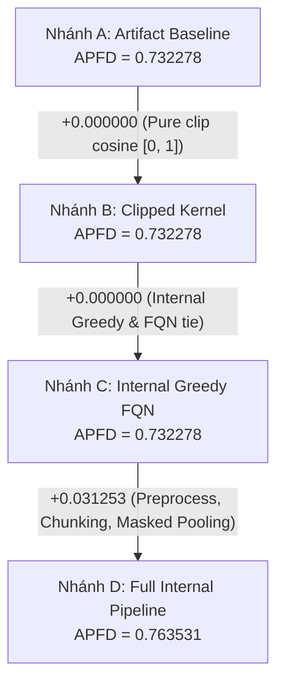

# Báo cáo chẩn đoán Bridge Chart A/B/C/D (Stage 10 - T08)

Báo cáo này phân rã và đo lường độc lập từng thành phần kỹ thuật tạo nên sự khác biệt giữa **artifact tác giả FALCON** và **pipeline nội bộ (Internal Pipeline)** trên bộ kiểm thử Chart (2.193 test methods, 26 fault IDs), tuân thủ đúng cam kết trong [README bàn giao](../10-handoff/README.md).

---

## 1. Thiết kế và cấu hình 4 nhánh Bridge

1. **Nhánh A (Artifact Baseline)**:
   - Vector: UniXcoder unmasked mean pooling của artifact tác giả.
   - Kernel: Cosine similarity thô (chứa 1.026 giá trị âm, giá trị nhỏ nhất: -0.085129).
   - Ranker: `FacilityLocation.lazy_greedy` với sai số $\epsilon = 10^{-6}$ và tie-breaking theo chỉ số dòng (input index).
2. **Nhánh B (Clipped Kernel)**:
   - Vector: **Trùng khớp 100% với Nhánh A** (`ef4c4387d0...`).
   - Kernel: Cắt ngưỡng cosine trực tiếp từ Kernel A về đoạn không âm $[0, 1]$ (`np.clip(kernel_A, 0.0, 1.0)`, không tính lại dot-product và không ép đường chéo, SHA-256: `d56f244348...`).
   - Ranker: Giữ nguyên `FacilityLocation.lazy_greedy` và index tie-breaking như A.
3. **Nhánh C (Internal Greedy FQN)**:
   - Vector: Trùng khớp 100% với Nhánh A.
   - Kernel: **Trùng khớp 100% với Nhánh B** (`d56f244348...`).
   - Ranker: Thuật toán heap greedy chính xác nội bộ (`hc_falcon.greedy.rank`) với cơ chế tie-breaking theo chuỗi FQN (Fully Qualified Name).
4. **Nhánh D (Full Internal Pipeline)**:
   - Vector: Sinh bởi `hc_falcon.semantic.Encoder` (tiền xử lý loại bỏ comment, chia chunk tối đa 16, masked attention pooling loại trừ padding token, chuẩn hóa L2).
   - Kernel: Cắt ngưỡng $[0, 1]$ (`hc_falcon.semantic.kernel`).
   - Ranker: Thuật toán greedy nội bộ với FQN tie-breaking như C.

---

## 2. Bảng kết quả định lượng chi tiết

Dữ liệu trích xuất từ [`reports/stage10/bridge/summary.json`](../../reports/stage10/bridge/summary.json):

| Nhánh | Tên nhánh | Vector SHA-256 (rút gọn) | Kernel SHA-256 (rút gọn) | Giá trị Kernel | Tie-Breaker | APFD | Thời gian (s) |
|:---:|---|:---:|:---:|:---:|:---:|:---:|:---:|
| **A** | **Artifact Baseline** | `ef4c4387d0` | `50dee65989` | $[-0.0851, 1.0000]$ | Input Index | **0.732278** | 0.08 |
| **B** | **Clipped Kernel** | `ef4c4387d0` | `d56f244348` | $[0.0000, 1.0000]$ | Input Index | **0.732278** | 34.86 |
| **C** | **Internal Greedy FQN** | `ef4c4387d0` | `d56f244348` | $[0.0000, 1.0000]$ | FQN String | **0.732278** | 1.06 |
| **D** | **Full Internal Pipeline** | `be413f0656` | `d82971fd3f` | $[0.0000, 1.0000]$ | FQN String | **0.763531** | 376.51 |

---

## 3. Phân tích các bước chuyển tiếp ($\Delta$) và So sánh Thứ tự Ranking

### Đối chiếu thứ tự hoán vị trực tiếp giữa các nhánh:
- **Nhánh A vs Nhánh B**: Ranking khác nhau tại **42 / 2.193 vị trí** (`A == B: False`). 10 phần tử đầu tiên giống hệt nhau (`[2091, 747, 1028, 1989, 1751, 1190, 2122, 1031, 165, 2081]`).
- **Nhánh B vs Nhánh C**: Ranking khác nhau tại **24 / 2.193 vị trí** (`B == C: False`). 10 phần tử đầu tiên giống hệt nhau.
- **Tại sao APFD bằng nhau tuyệt đối (0.732278)?**:
  - Khi kiểm tra thứ hạng phát hiện đầu tiên (first detection rank) của từng lỗi trong số 26 fault IDs: **cả 26 mốc phát hiện lỗi đầu tiên đều trùng khớp tuyệt đối giữa A, B và C** (tổng các thứ hạng phát hiện đầu tiên đều bằng đúng $15.278$, thứ hạng phát hiện lỗi muộn nhất đều là $1.677$).
  - Các vị trí hoán vị khác nhau (42 vị trí giữa A-B và 24 vị trí giữa B-C) chỉ xảy ra ở các test method không tham gia phát hiện lỗi mới (non-detecting test methods).

### Bước 1: $B - A$ (Ảnh hưởng của việc cắt ngưỡng Cosine âm thuần túy)
- $\Delta_{B - A} = +0.000000$ (APFD trùng khớp tuyệt đối).
- **Ý nghĩa**: Cắt ngưỡng cosine thô về $[0, 1]$ (`np.clip(kernel_A, 0.0, 1.0)`) làm thay đổi thứ tự ưu tiên của 42 test cases không phát hiện lỗi, nhưng không làm thay đổi thời điểm phát hiện của bất kỳ lỗi nào trong 26 faults của Chart. Do đó điểm APFD không đổi.

### Bước 2: $C - B$ (Ảnh hưởng của Thuật toán Ranker và Tie-Breaking)
- $\Delta_{C - B} = +0.000000$ (APFD trùng khớp tuyệt đối).
- **Ý nghĩa**: Chuyển từ `lazy_greedy` (upstream, index tie-breaker) sang thuật toán greedy heap nội bộ (FQN lexicographical tie-breaker) trên cùng ma trận kernel B làm thay đổi thứ tự ưu tiên của 24 test cases, nhưng cũng bảo toàn toàn bộ 26 mốc phát hiện lỗi đầu tiên. Ta không kết luận ranker là "tương đương tuyệt đối về hoán vị", mà kết luận rằng trong phạm vi đo lường của APFD trên Chart, sự thay đổi ranker và tie-breaking không tạo ra bất kỳ đóng góp nào vào mức tăng điểm của Nhánh D.

### Bước 3: $D - C$ (Ảnh hưởng của Pipeline Tiền xử lý & Masked Attention Pooling)
- $\Delta_{D - C} = +0.031253$ (+3.13 điểm phần trăm).
- **Ý nghĩa**: Đây là nguồn đóng góp **toàn bộ sự chênh lệch** (+3.13%). Việc tiền xử lý loại bỏ comment vô nghĩa, chia chunk cho các hàm dài và sử dụng attention mask (thay vì unmasked mean tính cả padding token) tạo ra các vector biểu diễn ngữ nghĩa sắc bén hơn, giúp thuật toán phát hiện các lỗi sớm hơn rõ rệt.

### Tổng thể: $D - A$ (Toàn bộ bước chuyển tiếp)
- $\Delta_{D - A} = +0.031253$ (+3.13 điểm phần trăm).

---

## 4. Ranh giới khoa học và kết luận bắt buộc

> [!CAUTION]
> **Không chọn nhánh tốt nhất để thay thế baseline LRTS**:
> - Điểm số của Nhánh D cao hơn Nhánh A trên Chart (+3.13%) là một phát hiện chẩn đoán cơ chế kỹ thuật (diagnostic finding).
> - **Tuyệt đối không** được dùng kết quả này để tùy tiện thay đổi baseline của LRTS hoặc tuyên bố pipeline nội bộ vượt trội trên môi trường CI thực tế.
> - Kết quả no-go của LRTS vẫn giữ nguyên hiệu lực khoa học.
