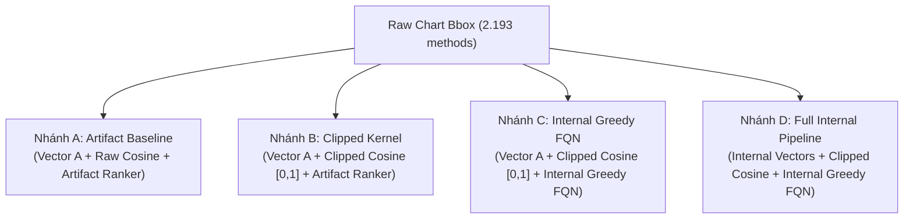

# Giao thức thực nghiệm tái lập Stage 10 (Protocol)

Tài liệu này xác định giao thức khoa học và kỹ thuật cho việc tái lập artifact FALCON trên 6 bộ kiểm thử Defects4J và chẩn đoán phân rã qua 4 nhánh Bridge Chart A/B/C/D, tuân thủ hợp đồng tại [README bàn giao](../10-handoff/README.md).

---

## 1. Nguyên tắc khoa học và bảo toàn bằng chứng

1. **Fidelity over Optimism**: Mục tiêu là tái lập trung thực hành vi của artifact tác giả FALCON, không sửa đổi logic, tham số hoặc quy tắc cắt tỉa vector để cố tình làm tăng điểm APFD.
2. **Đóng băng lịch sử**: Toàn bộ dữ liệu và báo cáo từ Stage 1 đến Stage 9 giữ nguyên trạng thái niêm phong (`freeze`). Không ghi đè cache cũ hoặc báo cáo cũ.
3. **Phân định ranh giới kết luận**:
   - Rerun artifact trên Defects4J là bài toán đánh giá độ tái lập của bộ mã nguồn tác giả trên 6 dự án độc lập.
   - Không đánh đồng 288 fault IDs của Defects4J thành 288 CI builds thực tế.
   - Kết quả tái lập Defects4J không thay thế hay đảo ngược kết quả no-go của LRTS trong các vòng thử nghiệm trước.

---

## 2. Thông số kỹ thuật Baseline Artifact (FALCON Reproduction)

Cấu hình được khóa tại [`configs/falcon-reproduction-v1.json`](../../configs/falcon-reproduction-v1.json):

| Tham số | Giá trị khóa | Ghi chú |
|---|---|---|
| **Mô hình** | `microsoft/unixcoder-base` | Revision `5604afdc964f6c53782a6813140ade5216b99006` |
| **Tokenization** | max_length=512, padding=True, truncation=True | Không thay đổi tokenizer config |
| **Môi trường** | CPU float32, torch threads = 4, seed = 0 | Đảm bảo tính tất định (deterministic) |
| **Batch size** | 16 (cố định) | Giữ nguyên biên batch vì pooling unmasked chịu ảnh hưởng bởi padding |
| **Pooling** | `outputs.last_hidden_state.mean(dim=1)` | Unmasked mean pooling chuẩn theo artifact gốc |
| **Kernel similarity** | `cosine` | Không clip âm, giá trị âm được giữ nguyên trong ma trận tương đồng |
| **Ranker** | `FacilityLocation.lazy_greedy` | Lazy evaluation với sai số $\epsilon = 10^{-6}$ |
| **Tie-breaking** | `torch.argmax` $\rightarrow$ smallest input index | Phá vỡ thế hòa bằng chỉ số dòng xuất hiện trước |

---

## 3. Danh mục dữ liệu đầu vào (6 Dự án Defects4J)

Khóa danh mục và ánh xạ tại [`reports/stage10/input-manifest.json`](../../reports/stage10/input-manifest.json):

| Thứ tự | Dự án | Số methods ($n$) | Số fault IDs ($m$) | Failing methods |
|:---:|---|:---:|:---:|:---:|
| 1 | **Chart** | 2.193 | 26 | 92 |
| 2 | **Mockito** | 1.292 | 27 | 86 |
| 3 | **Lang** | 2.239 | 32 | 87 |
| 4 | **Math** | 2.996 | 30 | 111 |
| 5 | **Time** | 4.044 | 26 | 90 |
| 6 | **Closure** | 8.006 | 147 | 467 |
| **Tổng** | **6 dự án** | **20.770** | **288** | **933** |

*Tất cả 288 fault IDs đều có ít nhất một test method phát hiện được (không có fault mồ côi).*

---

## 4. Công thức đánh giá APFD độc lập

Chỉ số APFD được tính toán độc lập dựa trên danh sách fault IDs:

$$APFD = 1 - \frac{\sum_{i=1}^{m} \text{first\_rank}(f_i)}{n \times m} + \frac{1}{2n}$$

Trong đó:
- $n$: Tổng số test methods trong tập kiểm thử đầy đủ.
- $m$: Tổng số fault IDs phát hiện được của dự án.
- $\text{first\_rank}(f_i)$: Thứ hạng (1-indexed) của test method đầu tiên trong hoán vị phát hiện lỗi $f_i$.
- Tuyệt đối không tính APFD cho các tập con chạy thử nghiệm (smoke/sample) vì $n$ chưa đầy đủ.

---

## 5. Thiết kế 4 nhánh Bridge Chart (A/B/C/D)

Khóa cấu hình tại [`configs/chart-bridge-v1.json`](../../configs/chart-bridge-v1.json):

- **Nhánh A (Artifact)**: Dùng embedding UniXcoder gốc, kernel cosine thô, ranker lazy greedy index-tie của artifact.
- **Nhánh B (Clipped Kernel)**: Giữ nguyên 100% vector của Nhánh A, chuyển kernel sang cắt ngưỡng không âm $[0, 1]$, ranker như A. Đo lường thuần túy tác động của việc cắt giá trị âm.
- **Nhánh C (Internal Greedy FQN)**: Dùng cùng kernel cắt âm của B, nhưng ranker chuyển sang thuật toán greedy chính xác nội bộ với cơ chế tie-breaking theo Fully Qualified Name (FQN).
- **Nhánh D (Full Internal Pipeline)**: Sử dụng toàn bộ pipeline nội bộ từ tiền xử lý code, chia chunk, masked UniXcoder embedding, kernel và ranker như C.

---

## 6. Chính sách Checkpoint, Resume và Giới hạn tài nguyên

1. **Atomic Checkpointing**: Checkpoint ghi theo từng block 16 test cases (đúng bằng batch size của encoder). Khi resume, worker bắt buộc phải tiếp tục từ đúng biên batch đó để đảm bảo padding token không bị thay đổi ngữ cảnh tính toán.
2. **Giới hạn tài nguyên vận hành**:
   - Bộ nhớ: Đỉnh RSS tối đa 8.0 GiB.
   - Thời gian: Tối đa 8.0 giờ wall-clock cho mỗi dự án.
   - Điều phối: Chỉ 1 worker tiến trình chạy tại một thời điểm.
