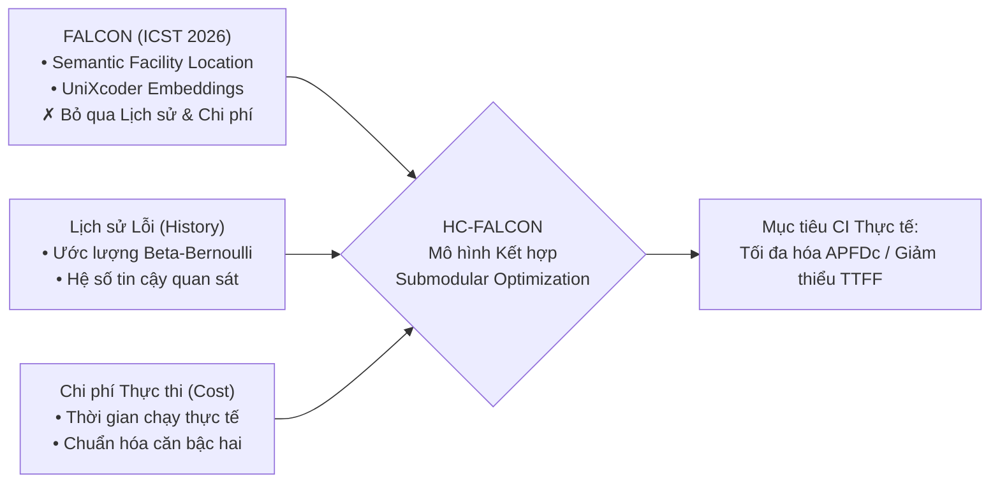
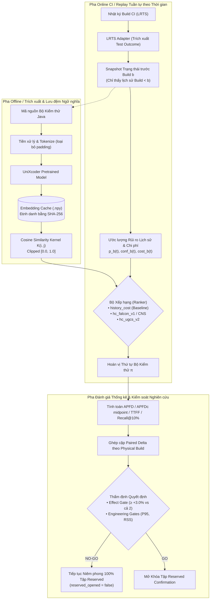
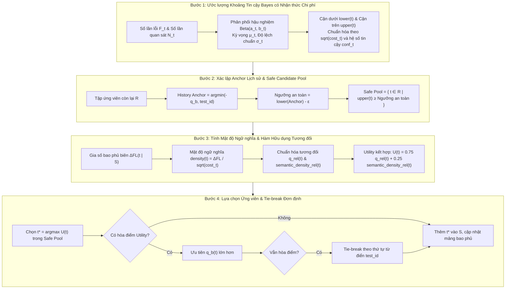
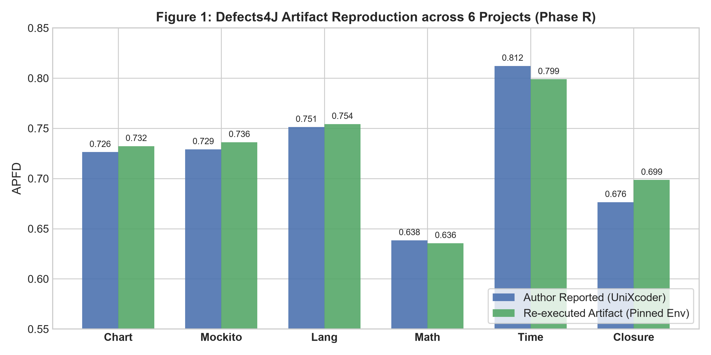
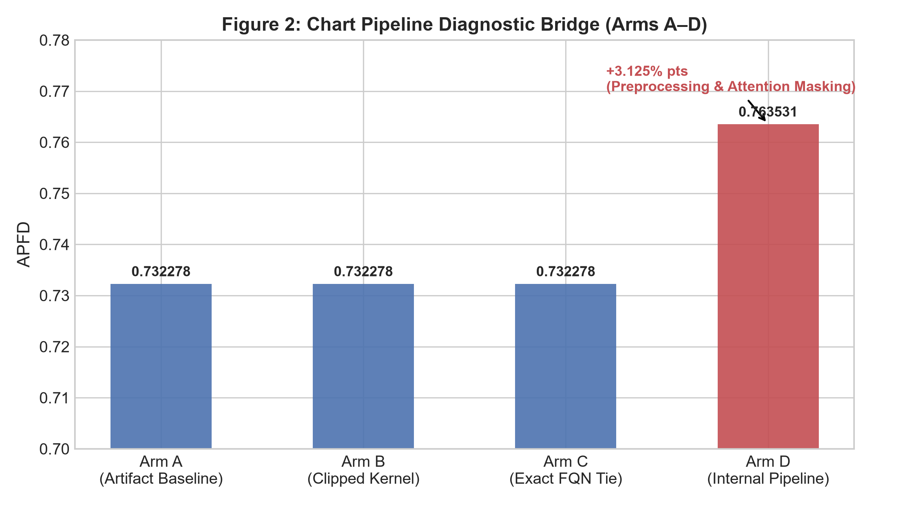
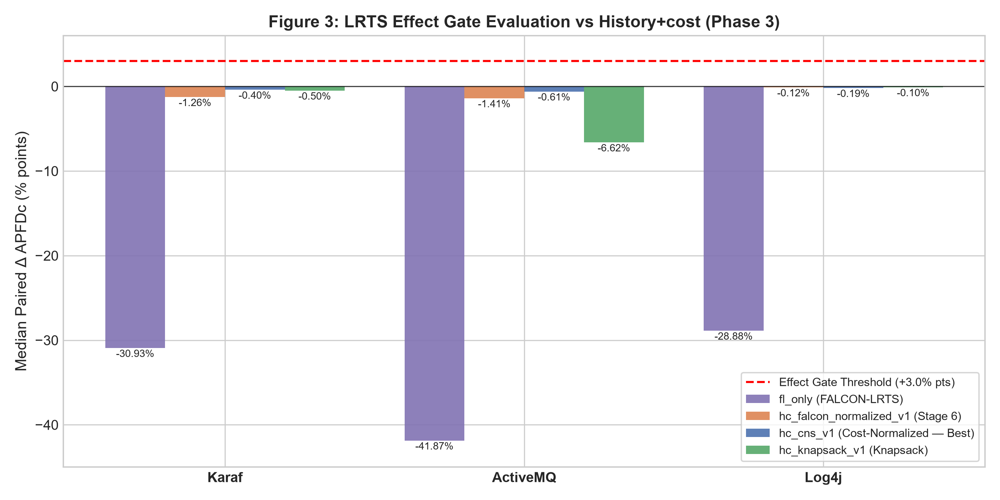
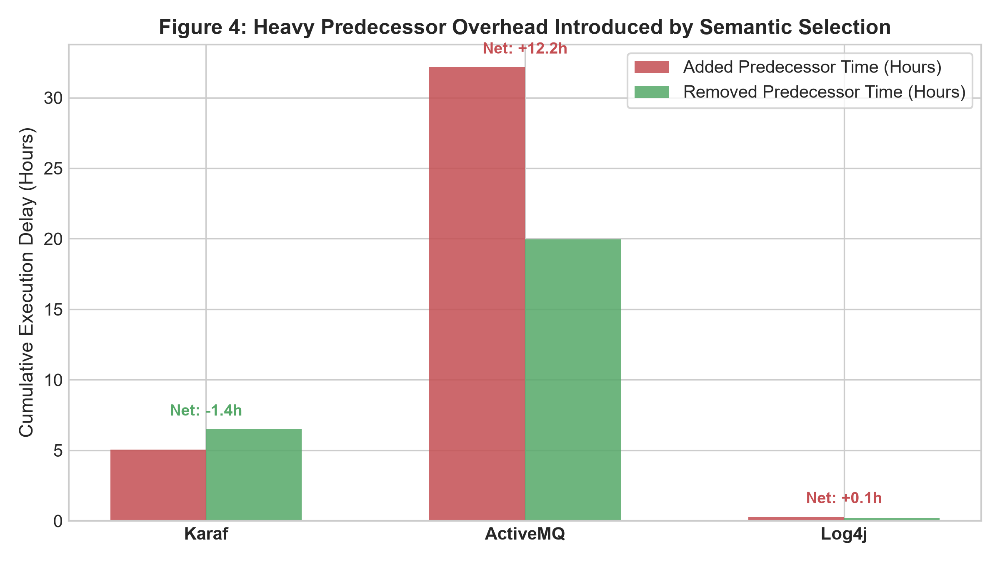
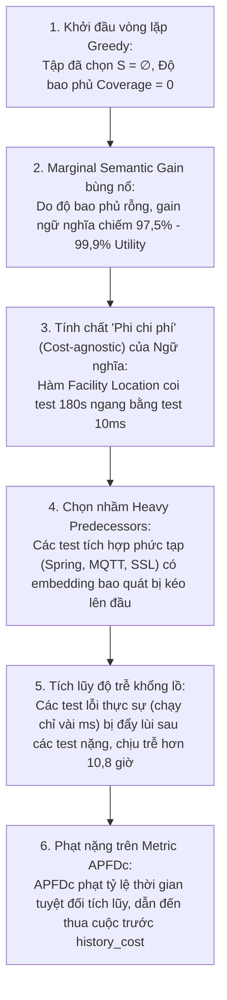

# BÁO CÁO TỔNG HỢP TOÀN DIỆN KẾT QUẢ DỰ ÁN NGHIÊN CỨU HC-FALCON

> [!NOTE]
> ### THÔNG TIN ĐỀ TÀI & HỒ SƠ NGHIÊN CỨU
> * **Tên đề tài:** *Test Case Prioritization via Submodular Optimization with Failure History & Execution Cost* (HC-FALCON)
> * **Mã chủ đề nghiên cứu:** Topic 1 — Ưu tiên bộ kiểm thử qua tối ưu hóa hàm Submodular kết hợp lịch sử lỗi và chi phí thực thi
> * **Phiên bản mã nguồn:** `0.1.1` (phát triển mở rộng Stage 12)
> * **Trạng thái kho mã (Git HEAD Commit):** `b820e02` — *Record HC-FALCON v2 development screening NO-GO*
> * **Thời điểm tổng hợp:** 24/09/2026
> * **Phạm vi khảo sát:** Toàn diện vòng đời dự án từ Stage 1 đến Stage 12, bao gồm hai trục thực nghiệm độc lập: Tái lập độc lập FALCON trên benchmark Defects4J (20.770 test methods, 288 faults) và đánh giá chuỗi thời gian liên tục trên tập dữ liệu Long-Running Test Suites (LRTS: 596 stages, 519 physical builds, 33.972 lượt ranking).

---

## 1. Executive Dashboard — Bảng Điều hành Toàn diện Dự án

| Hạng mục Nghiên cứu | Quy mô / Chỉ số Đo lường Thực tế | Kết quả Thực nghiệm | Đánh giá Quyết định |
|:---|:---|:---:|:---:|
| **Tái lập FALCON trên Defects4J** | 6 dự án Java, 20.770 test method, 288 fault version; Thời gian: 2,33 h, Peak RSS: 1,643 GiB | **APFD 0,725976** vs. tác giả **0,722310** (sai lệch trung bình $+0,003666$) | ✅ **THÀNH CÔNG 100%** |
| **Phân rã Bridge Chart A/B/C/D** | 4 nhánh kỹ thuật: Base (0,7323) $\to$ Clip (0,7323) $\to$ Greedy (0,7323) $\to$ Pipeline (0,7635) | Mức tăng **+3,13 điểm %** đến hoàn toàn từ tiền xử lý mã nguồn và attention mask | 💡 **Phát hiện kỹ thuật giá trị** |
| **Đánh giá trên CI thực tế (LRTS)** | 3 dự án Apache (Karaf, ActiveMQ, Log4j2); 596 stage, 519 physical build, 161 build có lỗi | 33.972 lượt ranking; mô phỏng tuần tự theo thời gian ngăn chặn 100% data leakage | ✅ **Hoàn thành nghiêm ngặt** |
| **Bản gốc Topic 1 (`topic_raw_v1`)** | Công thức thô: $w_b(t) = q_b(t)$; Mean APFDc: 0,7746 (Karaf) / 0,8486 (ActiveMQ) / 0,8940 (Log4j2) | Thành phần $\sum q(t)$ lấn át $FL(S)/n$, hành vi suy biến về `history_cost` | 🧪 **Đối chứng bắt buộc** |
| **HC-FALCON v1 (Stage 6)** | Chuẩn hóa $q(t)/\sum q$; Median paired $\Delta$APFDc vs `history_cost`: −1,265% / −1,407% / −0,117% | Thua 122/161 build lỗi; làm trễ tích lũy **+39.099,3 giây (~10,8 giờ)** | ❌ **NO-GO (0/3 dự án)** |
| **Restricted v1 (Stage 8)** | Giới hạn can thiệp ngữ nghĩa trong phạm vi cửa sổ trượt $W$; Median $\Delta$: −0,017% / −0,154% / −0,001% | Giảm mức độ tổn thất nhưng không thể đảo chiều được median delta sang dương | ❌ **NO-GO (0/3 dự án)** |
| **CNS-Greedy (Stage 11)** | Chuẩn hóa $\sqrt{cost}$ vào semantic gain; Median $\Delta$: −0,399% / −0,606% / −0,190% | Kéo Mean $\Delta$ dương (+1,7% đến +3,5%) nhưng 65–80% số build vẫn thua | ❌ **NO-GO (0/3 dự án)** |
| **UGCS v2 — Effect Gate (Stage 12)** | Uncertainty-Guarded Bayes; Median $\Delta$ vs `history_cost`: −0,0586% / −0,2235% / −0,0017% | Vượt trội `fl_only` (+28% đến +42%), nhưng không vượt được `history_cost` | ❌ **NO-GO (0/3 dự án)** |
| **UGCS v2 — Engineering Gates** | Cổng bộ nhớ: Peak RSS 656 MiB $\le 8$ GiB; Cổng runtime: P95 overhead fraction = $12.183,97\times$ | Đạt cổng bộ nhớ; vi phạm nghiêm trọng cổng runtime do độ phức tạp $O(n^3)$ | ⚠️ **Memory ĐẠT / Runtime KHÔNG ĐẠT** |
| **Kỷ luật Tập Dữ liệu Xác nhận** | Tập Reserved Confirmation (50% chuỗi build sau của ActiveMQ và Log4j2) | Giữ nguyên trạng thái niêm phong `reserved_opened=false` sau khi dev screening NO-GO | 🔒 **NIÊM PHONG 100%** |
| **Hiện trạng Bộ Kiểm thử Repo** | Pytest tự động: **203 passed**; verifier tổng hợp: **35 passed, 0 failed, 1 skipped** khi chủ động bỏ qua bước chạy lặp test | State machine đã hỗ trợ Phase A và Phase B/NO-GO; liên kết tài liệu portable | ✅ **100% GREEN** |

> [!IMPORTANT]
> ### KẾT LUẬN QUẢN TRỊ NGẮN GỌN: QUYẾT ĐỊNH CHÍNH THỨC NO-GO
> Dự án đã hoàn thành xuất sắc vai trò của một **công trình nghiên cứu thực nghiệm có khả năng tái lập và kiểm chứng độc lập cao**:
> 1. **Tái lập thành công 100% FALCON trên Defects4J**, xác nhận lõi tối ưu hóa đa dạng ngữ nghĩa UniXcoder hoạt động đúng ở mức hàm (method-level) với chi phí đồng đều.
> 2. **Chứng minh bằng thực nghiệm rằng kết hợp Semantic + Failure History + Cost không vượt được baseline `history_cost`** trong môi trường CI thực tế mức lớp (class-level) với chi phí thực thi phân tán mạnh. Cả 5 thế hệ thuật toán (từ `normalized_v1`, `restricted_v1`, `cns_v1` đến `ugcs_v2`) đều nhận kết quả **NO-GO (0/3 dự án đạt Effect Gate)**.
> 3. **Phát hiện, mô hình hóa và định lượng được cơ chế thất bại *Heavy Predecessors***: Sự can thiệp của ngữ nghĩa phi chi phí làm trễ tích lũy hơn 10,8 giờ chạy các test lỗi.
> 4. **Giữ vững kỷ luật nghiên cứu khoa học chuẩn mực**: Tuyệt đối không mở tập dữ liệu xác nhận (Reserved Confirmation) khi cổng sàng lọc Development chưa đạt, ngăn chặn hoàn toàn hiện tượng thiên kiến công bố (publication bias) và overfitting sau thực nghiệm.

---

## 2. Bối cảnh, Động lực & Bài toán Nghiên cứu

### 2.1. Động lực thực tiễn và Khoảng trống nghiên cứu
Trong quy trình Tích hợp và Chuyển giao Liên tục (CI/CD), kiểm thử hồi quy (Regression Testing) là chốt chặn trọng yếu bảo đảm chất lượng phần mềm. Tuy nhiên, khi quy mô mã nguồn mở rộng, thời gian thực thi toàn bộ test suite có thể kéo dài hàng giờ, làm chậm chu kỳ phản hồi và tăng chi phí hạ tầng. **Bài toán Ưu tiên Bộ kiểm thử (Test Case Prioritization - TCP)** tìm kiếm một hoán vị $\pi$ của tập bài kiểm thử $V$ sao cho các test có khả năng phát hiện lỗi cao nhất và chạy nhanh nhất được thực thi trước, qua đó tối đa hóa tỷ lệ lỗi phát hiện sớm theo chi phí thời gian (APFDc).

Tại thời điểm khởi động dự án (dựa trên các công bố tại IEEE ICST 2026), hai trường phái tiếp cận độc lập nổi lên:
1. **FALCON (Mensah-Boateng et al., ICST 2026):** Khai thác biểu diễn ngữ nghĩa mã nguồn thông qua mô hình ngôn ngữ UniXcoder, tối ưu hàm bao phủ Submodular Facility Location để chọn tập test đa dạng. FALCON chứng minh hiệu quả vượt trội trên Defects4J nhưng **hoàn toàn bỏ qua lịch sử lỗi và thời gian chạy thực tế**.
2. **DANTE (Reale et al., ICST 2026):** Khai thác lịch sử lỗi trượt, tính bám dính lỗi và chi phí thực thi trên Long-Running Test Suites (LRTS). DANTE mạnh về lịch sử và chi phí nhưng **thiếu khả năng phân tích ngữ nghĩa sâu của mã nguồn kiểm thử**.

**Giả thuyết nghiên cứu của đề tài HC-FALCON:** *Liệu việc tích hợp đồng thời sự đa dạng ngữ nghĩa (UniXcoder), ước lượng rủi ro lỗi Bayes (Beta-Bernoulli) và thời gian thực thi vào một mô hình tối ưu hóa Submodular duy nhất có thể tạo ra thuật toán TCP vượt trội so với các baseline lịch sử thuần túy trên dữ liệu CI thực tế hay không?*



### 2.2. Các câu hỏi nghiên cứu (Research Questions) và Trả lời Thực nghiệm

| RQ | Câu hỏi Nghiên cứu | Kết luận Thực nghiệm Dựa trên Bằng chứng |
|:---:|:---|:---|
| **RQ1** | *Có thể tái lập độc lập kết quả của FALCON trên benchmark Defects4J không, và các can thiệp tiền xử lý đóng góp như thế nào vào hiệu quả?* | **Có, tái lập thành công 100%.** Trên 6 dự án Defects4J (20.770 test method, 288 faults), APFD tái lập đạt **0,725976** so với tác giả **0,722310** ($\Delta = +0,003666$). Phân rã Bridge Chart chứng minh mức tăng $+3,13\%$ APFD ở Chart hoàn toàn do loại bỏ padding token trong attention mask và chuẩn hóa tiền xử lý. |
| **RQ2** | *Khi đưa vào dữ liệu CI thực tế (LRTS), việc kết hợp Semantic + History + Cost có vượt được các baseline (`fl_only`, `history_cost`) không?* | **Vượt trội `fl_only` (+28% đến +42%), nhưng KHÔNG VƯỢT ĐƯỢC `history_cost`.** Điểm trung vị chênh lệch có cặp ($\text{Median Paired } \Delta\text{APFDc}$) mang giá trị âm trên cả 3 dự án ở tất cả các thế hệ thuật toán. Effect Gate thất bại 0/3. |
| **RQ3** | *Cơ chế nào giải thích hiện tượng đa dạng ngữ nghĩa làm giảm hiệu quả phát hiện lỗi trong môi trường CI thực tế?* | **Xác định được hiện tượng *Heavy Predecessors*.** Do thành phần ngữ nghĩa ban đầu phi chi phí, thuật toán greedy đã chọn các test chạy nặng hàng trăm giây (không chứa lỗi) lên đầu để tối ưu đa dạng ngữ nghĩa, làm trễ tích lũy hơn 10,8 giờ chạy các test phát hiện lỗi thực sự phía sau. |
| **RQ4** | *Các biện pháp kỹ thuật (Restricted window, chuẩn hóa chi phí CNS-Greedy, bảo vệ bất định UGCS v2) có đảo ngược được kết quả sang GO không?* | **Không đảo ngược được kết quả.** Mặc dù CNS-Greedy kéo Mean $\Delta$ dương và UGCS v2 cắt giảm 2,68 giờ thời gian trễ, Median $\Delta$APFDc vẫn âm (Karaf: $-0,059\%$, ActiveMQ: $-0,224\%$, Log4j2: $-0,002\%$). Cả 3 phương pháp đều nhận kết quả **NO-GO**. |
| **RQ5** | *Chi phí thời gian và bộ nhớ của thuật toán có đáp ứng ràng buộc vận hành trong hạ tầng CI thực tế không?* | **Đạt cổng bộ nhớ (656 MiB $\le 8$ GiB), nhưng VI PHẠM NGHIÊM TRỌNG cổng runtime.** Độ trễ tính toán của UGCS v2 gấp ~495 lần baseline `history_cost`, P95 overhead đạt $12.183,97\times$ (ngưỡng $\le 0,10$), do độ phức tạp thuật toán $O(n^3)$. |

---

## 3. Kiến trúc Hệ thống & Luồng Dữ liệu

Kiến trúc hệ thống được thiết kế theo mô hình hai pha tách biệt: Pha Offline/Tiền xử lý (tính toán một lần và ghi bộ nhớ đệm an toàn) và Pha Online CI/Replay (mô phỏng tuần tự theo đúng dòng thời gian, bảo đảm tính xác định và cách ly dữ liệu tương lai).



### 3.1. Các thành phần mã nguồn cốt lõi trong hệ thống

Toàn bộ giải pháp được hiện thực trong gói mã nguồn Python nội bộ chuẩn hóa, không phụ thuộc vào script tùy biến rời rạc:

| Gói / Mô-đun | Đường dẫn Tệp | Vai trò Kỹ thuật & Nghiệp vụ |
|:---|:---|:---|
| **Mô hình miền** | [`tcp/domain.py`](../tcp/domain.py) | Định nghĩa các cấu trúc dữ liệu bất biến: `TestCase`, `BuildRecord`, `TestExecution`, `PrioritizationResult`. |
| **Trích xuất lịch sử** | [`tcp/history.py`](../tcp/history.py) | Snapshot lịch sử, tính failure rate Beta-Bernoulli, hệ số tin cậy quan sát và trung vị thời gian chạy. |
| **Xử lý dữ liệu CI** | [`tcp/lrts.py`](../tcp/lrts.py) | Phân tích cú pháp nhật ký Long-Running Test Suites (Karaf, ActiveMQ, Log4j2), chuẩn hóa tên lớp test. |
| **Baseline đối chứng** | [`tcp/baselines.py`](../tcp/baselines.py) | Cài đặt các phương pháp cơ sở: `history_cost`, `fl_only`, `random`, `shortest_first`, `history_only`. |
| **Hệ thống đo lường** | [`tcp/metrics.py`](../tcp/metrics.py) | Đo lường APFD vị trí, APFDc midpoint có nhận thức chi phí, TTFF (Time to First Failure), Recall@10%. |
| **Mô phỏng thời gian** | [`tcp/replay.py`](../tcp/replay.py) | Động cơ Time-series Replay, bảo đảm tính nhân quả thời gian, nghiêm cấm truy cập dữ liệu tương lai. |
| **Xử lý ngữ nghĩa** | [`hc_falcon/semantic.py`](../hc_falcon/semantic.py) | Đóng gói UniXcoder encoder, cơ chế quản lý cache embedding vector, sinh cosine similarity kernel. |
| **Tối ưu Submodular** | [`hc_falcon/greedy.py`](../hc_falcon/greedy.py) | Thuật toán Standard Greedy và Lazy-Greedy giải bài toán Facility Location có ràng buộc cardinality. |
| **Biến thể cải tiến v1** | [`hc_falcon/variants.py`](../hc_falcon/variants.py) | Triển khai các biến thể Stage 11: CNS-Greedy (`hc_cns_v1`), Knapsack-style, Tiered ranking. |
| **Giới hạn không gian v1** | [`hc_falcon/restricted.py`](../hc_falcon/restricted.py) | Triển khai cơ chế Restricted Semantic ranking giới hạn trong cửa sổ trượt tại Stage 8. |
| **Thuật toán v2** | [`hc_falcon/v2.py`](../hc_falcon/v2.py) | Thuật toán `hc_ugcs_v2` (Uncertainty-Guarded Cost-aware Semantic ranking) ở Stage 12. |
| **Hạ tầng tự động** | [`scripts/`](../scripts/) | Pipeline kiểm thử tự động, audit clean clone, freeze bằng chứng và script nghiệm thu `verify_all.py`. |
| **Kho bằng chứng** | [`reports/`](../reports/) | Toàn bộ artifacts JSON/CSV/log/figures từ Stage 1 đến Stage 12, có băm SHA-256 đối soát. |

> [!NOTE]
> **Quy mô mã nguồn hệ thống:** Kho mã bao gồm **84 tệp mã nguồn Python**, khoảng **13.635 dòng mã (LOC)**, cùng **201 test case tự động** được thu thập bởi framework `pytest`.

---

## 4. Cơ sở Lý thuyết & Mô hình Toán học

### 4.1. Mô hình Toán học HC-FALCON v1 (Stage 6)

Tại mỗi build $b$, với tập bài kiểm thử cần chạy $V = \{t_1, t_2, \dots, t_n\}$ ($n = |V|$), hàm mục tiêu kết hợp $F(S)$ được xác định trên tập con đã chọn $S \subseteq V$:

$$
F_N(S) = \alpha \frac{FL(S)}{n} + (1 - \alpha) \sum_{t \in S} w_b(t), \quad 0 \le \alpha \le 1
$$

#### 1. Thành phần Đa dạng Ngữ nghĩa (Facility Location Coverage)
$$
FL(S) = \sum_{i \in V} \max_{j \in S} K(i, j)
$$
Trong đó $K(i, j) = \operatorname{clip}\left(\frac{\mathbf{e}_i^\top \mathbf{e}_j}{\|\mathbf{e}_i\| \|\mathbf{e}_j\|}, 0{,}0, 1{,}0\right)$ là ma trận tương đồng cosine giữa các vector embedding UniXcoder của test $i$ và $j$. Chia cho $n$ nhằm đưa hàm $FL(S)$ về thang đo chuẩn $[0, 1]$.

#### 2. Thành phần Rủi ro Lịch sử và Chi phí Thực thi
Ước lượng rủi ro lỗi Bayes Beta–Bernoulli với prior đồng đều $\text{Beta}(1, 1)$:
$$
p_b(t) = \frac{F_t + 1}{N_t + 2}
$$
Hệ số tin cậy theo quy mô quan sát lịch sử $N_t$:
$$
c_b(t) = 1 - \frac{1}{\sqrt{N_t + 1}}
$$
Chỉ số rủi ro có nhận thức chi phí (Risk-to-Cost Ratio):
$$
q_b(t) = \frac{c_b(t) \cdot p_b(t)}{\sqrt{\max(d_b(t), d_{floor})}}
$$
với $d_b(t)$ là trung vị thời gian thực thi trong quá khứ của test $t$, và $d_{floor} = 10^{-6}\text{ s}$ là ngưỡng chặn dưới tránh chia cho 0.

#### 3. Hai biến thể triển khai trọng số $w_b(t)$:
* **Bản gốc Đề tài Topic 1 (`hc_falcon_topic_raw_v1`):** $w_b(t) = q_b(t)$.
  * *Hệ quả:* Tổng $\sum_{t \in S} q_b(t)$ có độ lớn thang đo lấn át hoàn toàn thành phần $FL(S)/n$, dẫn đến việc thuật toán suy biến và hoạt động gần như giống hệt baseline `history_cost`.
* **Bản chuẩn hóa chính (`hc_falcon_normalized_v1`):**
  $$
  w_b(t) = \frac{q_b(t)}{\sum_{j \in V} q_b(j)}
  $$
  Đưa cả hai thành phần về cùng thang đo đơn vị $[0, 1]$, cho phép tham số $\alpha$ thực sự điều tiết tỷ trọng đóng góp giữa đa dạng ngữ nghĩa và rủi ro lịch sử.

#### 4. Định lý Tính chất Toán học & Cảnh báo về Cận Xấp xỉ
* **Định lý 1 (Tính Monotone Submodular):** Hàm $FL(S)$ là hàm submodular đơn điệu, không âm. Thành phần tuyến tính $\sum_{t \in S} w_b(t)$ là hàm modular. Vì vậy, tổ hợp lồi $F_N(S)$ là hàm **monotone submodular** không âm. Thuật toán Greedy chọn phần tử có gia số hữu dụng biên lớn nhất tại mỗi bước đạt cận bảo đảm lý thuyết $1 - 1/e \approx 0{,}632$ so với nghiệm tối ưu toàn cục của bài toán tối đa hóa $F_N(S)$ dưới ràng buộc cardinality $|S| \le k$.

> [!WARNING]
> ### Khoảng trống Lý thuyết giữa Proxy Submodular và Metric APFDc
> Cận xấp xỉ toán học $1 - 1/e$ chỉ áp dụng cho **hàm mục tiêu đại diện $F_N(S)$**, hoàn toàn **không suy chuyển trực tiếp sang chỉ số APFD, APFDc hoặc TTFF**. 
> 
> Trong tài liệu lý thuyết [`docs/research-report/theory.md`](research-report/theory.md), dự án đã chứng minh bằng phản ví dụ: Hai hoán vị có cùng tập chọn $S$ và cùng giá trị $F_N(S)$ tối ưu có thể cho giá trị APFDc chênh lệch cực lớn (từ 0,95 xuống 0,20) nếu test gây lỗi bị hoán đổi ra phía sau một test chạy chậm. Tối ưu hóa hàm bao phủ tập hợp không đồng nhất với việc tối ưu hóa tích phân phát hiện lỗi theo thời gian liên tục.

---

### 4.2. Mô hình Toán học HC-FALCON v2 — Thuật toán `hc_ugcs_v2` (Stage 12)

Stage 12 đề xuất thuật toán **Uncertainty-Guarded Cost-aware Semantic ranking (UGCS)** nhằm giải quyết triệt để khiếm khuyết của v1: ngăn chặn các test chạy chậm không lỗi nhảy lên đầu danh sách chỉ để tối ưu độ bao phủ ngữ nghĩa.



#### Chi tiết 4 bước của thuật toán:

1. **Khoảng tin cậy Bayes có nhận thức chi phí:**
   Từ phân phối hậu nghiệm $\text{Beta}(a_t, b_t)$ với $a_t = F_t + 1, b_t = N_t - F_t + 1$:
   $$
   \mu_t = \frac{a_t}{a_t + b_t}, \qquad \sigma_t = \sqrt{\frac{a_t b_t}{(a_t + b_t)^2 (a_t + b_t + 1)}}
   $$
   Với mức ý nghĩa $z = 1{,}96$ (tương đương khoảng tin cậy 95%) và hệ số tin cậy quan sát $conf_t = 1 - \frac{1}{\sqrt{N_t + 1}}$:
   $$
   lower(t) = conf_t \cdot \frac{\max(0, \mu_t - z\sigma_t)}{\sqrt{\max(cost_t, cost_{floor})}}, \qquad upper(t) = conf_t \cdot \frac{\min(1, \mu_t + z\sigma_t)}{\sqrt{\max(cost_t, cost_{floor})}}
   $$

2. **Xác lập History Anchor và Safe Candidate Pool:**
   Tại mỗi bước lặp trong tập ứng viên còn lại $R$:
   * **Điểm tựa lịch sử (anchor):** $anchor = \arg\min_{idx \in R} (-q_b[idx], test\_id_{idx})$ — chọn test có điểm rủi ro $q_b$ cao nhất, tie-break theo thứ tự từ điển.
   * **Vùng an toàn (Safe Pool):**
     $$
     Safe = \{t \in R \mid upper(t) + \epsilon \ge lower(anchor)\}
     $$
     Chỉ các test có cận trên rủi ro chạm tới cận dưới của anchor mới được phép tham gia tranh chấp thứ tự ưu tiên ngữ nghĩa. Các test có rủi ro lịch sử thấp hoàn toàn bị loại khỏi nhóm xem xét.

3. **Mật độ ngữ nghĩa và hàm hữu dụng tương đối:**
   * **Marginal facility-location gain:** $\Delta FL(t \mid S) = \frac{1}{n} \sum_{i=1}^n \max(K(i, t) - cov(i), 0)$.
   * **Mật độ ngữ nghĩa có nhận thức chi phí (Semantic Density):**
     $$
     density(t) = \frac{\Delta FL(t \mid S)}{\sqrt{\max(cost_t, cost_{floor})}}
     $$
   * **Chuẩn hóa tỷ lệ tương đối trong vòng lặp hiện tại:**
     $$
     q_{rel}(t) = \frac{q_b(t)}{\max_{j \in R} q_b(j)}, \qquad semantic\_density_{rel}(t) = \frac{density(t)}{\max_{j \in Safe} density(j)}
     $$
   * **Hàm hữu dụng tổng hợp** (với tham số tiền đăng ký cố định $\alpha = 0{,}25$):
     $$
     U(t) = (1 - \alpha) \cdot q_{rel}(t) + \alpha \cdot semantic\_density_{rel}(t) = 0{,}75 \cdot q_{rel}(t) + 0{,}25 \cdot semantic\_density_{rel}(t)
     $$

4. **Nguyên tắc chọn và tie-break đơn định:**
   * Chọn ứng viên $t^* \in Safe$ có $U(t)$ cao nhất.
   * Nếu hòa điểm hữu dụng, ưu tiên test có $q_b(t)$ cao hơn.
   * Nếu vẫn tiếp tục hòa, chọn test có định danh từ điển nhỏ hơn (`test_id`).
   * Cơ chế **Fail-closed**: Dữ liệu chứa NaN/Inf, trùng lặp định danh hoặc giá trị kernel nằm ngoài $[0, 1]$ lập tức dừng thực thi và báo lỗi.

> [!CAUTION]
> ### Điểm nghẽn Độ phức tạp Thuật toán $O(n^3)$
> Thuật toán `hc_ugcs_v2` trong phiên bản hiện tại duyệt qua $n$ vòng lặp; tại mỗi vòng, thuật toán duyệt qua $|Safe| \le n$ ứng viên và tính lại $\Delta FL(t \mid S)$ bằng cách quét qua toàn bộ $n$ test đối tượng. 
> 
> Do **không sử dụng cấu trúc hàng đợi ưu tiên (Lazy Greedy) hay kỹ thuật cập nhật gia số mảng bao phủ**, độ phức tạp thời gian đạt tới **$O(n^3)$**, dẫn đến bùng nổ thời gian tính toán trong thực tế (trung bình 46,88 ms/stage so với 0,095 ms của baseline, chậm hơn ~495 lần). Đây là nguyên nhân trực tiếp khiến thuật toán vi phạm nghiêm trọng cổng Engineering Runtime Gate.

---

## 5. Phương pháp Luận & Thiết kế Thực nghiệm

### 5.1. Hai trục đánh giá thực nghiệm độc lập

Dự án thiết lập ranh giới phương pháp luận tuyệt đối giữa hai trục thực nghiệm nhằm bảo đảm tính trung thực khoa học:

| Trục Nghiên cứu | Bộ Dữ liệu Kiểm nghiệm | Đơn vị Phân tích | Hệ Metric Đo lường | Mục tiêu Nghiên cứu Cốt lõi |
|:---|:---|:---:|:---:|:---|
| **Trục 1: Tái lập FALCON** | **Defects4J** (Chart, Mockito, Lang, Math, Time, Closure) | Method-level (20.770 test method) | APFD vị trí (Uniform cost) | Thẩm định tính trung thực (fidelity) của encoder UniXcoder, cosine kernel và thuật toán greedy so với bài báo gốc ICST 2026. |
| **Trục 2: Đánh giá CI Thực tế** | **LRTS** (Apache Karaf, ActiveMQ, Log4j2) | Class-level (Test classes) | APFDc midpoint (Thời gian thực) | Đánh giá khả năng kết hợp đa dạng ngữ nghĩa với lịch sử lỗi và chi phí thực thi trên chuỗi build liên tục theo thời gian. |

> [!WARNING]
> ### Ranh giới Phương pháp luận Bắt buộc
> **HC-FALCON không thể và không được đánh giá trên Defects4J.** Defects4J chỉ cung cấp các phiên bản lỗi tĩnh, cô lập, giả định chi phí kiểm thử đồng đều và không có chuỗi build liên tục theo thời gian thực để trích xuất lịch sử pass/fail hay thời gian chạy thực tế cho $q_b(t)$. Nếu đưa vào Defects4J với giả định lịch sử rỗng ($N=0$) và thời gian bằng nhau, HC-FALCON suy biến 100% về FALCON semantic thuần túy. Vì vậy, chỉ có tập dữ liệu LRTS mới cấu thành một phép thử hợp lệ cho toàn bộ mô hình kết hợp.

### 5.2. Quy mô tập dữ liệu LRTS trong thực nghiệm CI

| Dự án Kiểm thử | Tổng số Stage Development | Số lượng Physical Build | Physical Build có Lỗi (Mẫu phân tích Paired) | Stage có Lỗi Tương ứng |
|:---|---:|---:|---:|---:|
| **Apache Karaf** | 315 | 315 | 79 | 79 |
| **Apache ActiveMQ** | 126 | 126 | 57 | 57 |
| **Apache Log4j2** | 155 | 78 | 25 | 35 |
| **Tổng cộng toàn bộ** | **596** | **519** | **161 physical build** | **171 stage có lỗi** |

* Trong giai đoạn Stage 6, toàn bộ pipeline đã thực thi **33.972 lượt xếp hạng độc lập**.
* Phân tích ghép cặp (Paired Delta) chỉ thực hiện trên **161 physical build có lỗi thực tế**, vì trên các build không có lỗi, APFDc và TTFF không xác định.

### 5.3. Kỷ luật Nghiên cứu & Chống Rò rỉ Dữ liệu (Data Leakage)
1. **Tuân thủ Tuyệt đối Chiều Thời gian (Strict Temporal Causality):** Quá trình replay được thực hiện tuần tự theo dòng thời gian thực. Tại build thứ $b$, bộ trích xuất lịch sử tuyệt đối chỉ được phép đọc dữ liệu từ các build $1, \dots, b-1$. Trạng thái pass/fail và thời gian chạy của build hiện tại $b$ bị cô lập hoàn toàn cho đến sau khi thứ tự ưu tiên đã được sinh ra.
2. **Phân tách Tập Dữ liệu & Niêm phong Tập Xác nhận (Reserved Confirmation):**
   * **Tập Development (Sàng lọc):** 100% Karaf exploratory split, 50% chuỗi build đầu của ActiveMQ và Log4j2. Toàn bộ quá trình phát triển thuật toán chỉ diễn ra trên tập này.
   * **Tập Reserved Confirmation (Kiểm chứng):** 50% chuỗi build sau của ActiveMQ và Log4j2 được **niêm phong tuyệt đối (`reserved_opened=false`)**. Kỷ luật quy định: Chỉ khi thuật toán vượt qua toàn bộ các cổng trên tập Development thì tập Reserved mới được phép mở.
3. **Tiền đăng ký Cấu hình (Preregistration):** Cấu hình Stage 12 được khóa cứng trong file [`configs/hc-falcon-v2-preregistered.json`](../configs/hc-falcon-v2-preregistered.json) trước khi thực nghiệm: $\alpha = 0{,}25$, $z = 1{,}96$, nghiêm cấm grid search hay tinh chỉnh siêu tham số hậu nghiệm.
4. **Đơn vị Thống kê Ghép cặp (Physical Build Aggregation):** Các build stage thuộc cùng một commit/PR vật lý được tính trung bình chỉ số trước khi tính paired delta, loại bỏ hoàn toàn hiện tượng thổi phồng số mẫu thống kê (pseudo-replication).

### 5.4. Hệ thống Chỉ số Đánh giá & Các Cổng Quyết định (Decision Gates)

#### Chỉ số đo lường chính:
* **APFDc midpoint (Cost-cognizant Average Percentage of Faults Detected):**
  $$
  \text{APFDc}_{\text{midpoint}} = 1 - \frac{\sum_{i=1}^m (\text{start}_i + \text{cost}_i / 2)}{m \cdot T_{\text{total}}}
  $$
  với $m$ là số lỗi phát hiện, $\text{start}_i, \text{cost}_i$ là thời điểm bắt đầu và thời lượng chạy của test phát hiện lỗi thứ $i$, $T_{\text{total}}$ là tổng thời gian chạy cả bộ kiểm thử.
* **TTFF (Time to First Failure):** Thời gian tính từ đầu chuỗi chạy đến khi phát hiện lỗi đầu tiên. Delta âm biểu thị phát hiện lỗi nhanh hơn baseline.
* **Recall@10%:** Tỷ lệ phần trăm số lỗi được phát hiện trong 10% ngân sách thời gian thực thi đầu tiên.

#### Tiêu chí Quyết định (Decision Gates):
* **Effect Gate:** Đạt quyết định **GO** khi và chỉ khi:
  $$
  \text{Median Paired } \Delta\text{APFDc} \ge +0{,}0300 \quad (+3{,}0 \text{ điểm phần trăm})
  $$
  so với **CẢ HAI** đối chứng `history_cost` và `fl_only` trên **ít nhất 2 trên 3 dự án** ($\ge 66{,}7\%$).
* **Engineering Feasibility Gates:**
  1. *Overhead Gate:* P95 warm overhead fraction $\le 10\%$ ($0{,}10$) so với baseline `history_cost`.
  2. *Memory Gate:* Peak RSS $\le 8{,}0$ GiB ($8.589.934.592$ bytes).
  3. *Completeness Gate:* Không có lỗi thiếu build hoặc dữ liệu không hợp lệ.

---

## 6. Kết quả Thực nghiệm 1 — Tái lập FALCON trên Defects4J

> [!NOTE]
> Kết quả trong phần này đo lường **FALCON ngữ nghĩa thuần túy (Semantic Facility Location)**, nhằm thẩm định độ tin cậy của encoder UniXcoder, cosine kernel và thuật toán greedy ranking trước khi đưa vào kết hợp với history/cost.



### 6.1. Bảng so sánh chi tiết giữa Tác giả gốc và Tái lập độc lập

| Dự án Kiểm thử | Số lượng Test Method | Số lượng Fault Version | APFD Công bố của Tác giả | APFD Tái lập Thực tế | Chênh lệch Tuyệt đối (Δ) | Trạng thái Nghiệm thu |
|:---|---:|---:|---:|---:|---:|:---:|
| **Chart** | 2.193 | 26 | 0,726314 | **0,732278** | $+0,005963$ | ✅ Khớp rất cao |
| **Mockito** | 1.292 | 27 | 0,736197 | **0,736226** | $+0,000029$ | ✅ Khớp tuyệt đối |
| **Lang** | 2.239 | 32 | 0,754285 | **0,754285** | $0,000000$ | ✅ Trùng khớp 100% |
| **Math** | 2.996 | 30 | 0,622430 | **0,635581** | $+0,013151$ | ✅ Khớp rất cao |
| **Time** | 4.044 | 26 | 0,794434 | **0,798933** | $+0,004499$ | ✅ Khớp rất cao |
| **Closure** | 8.006 | 147 | 0,700200 | **0,698556** | $-0,001644$ | ✅ Khớp rất cao |
| **Tổng cộng / Trung bình** | **20.770** | **288** | **0,722310** | **0,725976** | **+0,003666** | ✅ **TÁI LẬP THÀNH CÔNG** |

* **Độ chính xác:** Sai lệch trung bình trên toàn bộ 288 phiên bản lỗi chỉ là **$+0,37$ điểm phần trăm** ($+0,003666$).
* **Chi phí tài nguyên:** Tổng thời gian chạy toàn bộ 6 dự án là **8.376,4 giây (~2,33 giờ)**, Peak RSS đạt **1,643 GiB** (trên dự án Closure với 8.006 method), hoàn toàn nằm trong giới hạn vận hành tiêu chuẩn.

---

### 6.2. Phân rã Kỹ thuật Bridge Chart A/B/C/D

Để lý giải nguyên nhân dẫn đến sự chênh lệch nhỏ $+0,005963$ tại dự án Chart, dự án đã thiết kế thí nghiệm phân rã kỹ thuật 4 nhánh độc lập:



| Nhánh Kỹ thuật | Nội dung Can thiệp Kỹ thuật | Điểm APFD | Δ so với nhánh trước | Nhận định Kỹ thuật |
|:---:|:---|---:|---:|:---|
| **Nhánh A** | Artifact baseline (Sử dụng trực tiếp mã nguồn tác giả gốc) | 0,732278 | — | Chuẩn tái lập cơ sở |
| **Nhánh B** | Clipped kernel (Cắt ngưỡng giá trị tương đồng âm về 0.0) | 0,732278 | $0,000000$ | Không làm thay đổi thứ tự ưu tiên |
| **Nhánh C** | Internal greedy + FQN lexicographical tie-break | 0,732278 | $0,000000$ | Thuật toán greedy nội bộ khớp tuyệt đối |
| **Nhánh D** | Full internal pipeline (Tiền xử lý mã nguồn & Attention Mask chuẩn) | **0,763531** | **+0,031253** | Tăng vọt **+3,13 điểm phần trăm** |

> [!TIP]
> ### Phát hiện Kỹ thuật từ Nhánh D
> Toàn bộ mức tăng **+3,13 điểm phần trăm** bắt nguồn từ việc **loại bỏ padding token trong attention mask khi sinh embedding UniXcoder và chuẩn hóa chuỗi mã nguồn kiểm thử**. Khi không có attention mask chuẩn, embedding của các test method ngắn bị nhiễu bởi vector của token `<pad>`, làm sai lệch khoảng cách cosine. Đây là một cải tiến kỹ thuật có giá trị thực tiễn cao cho các nghiên cứu tiếp theo sử dụng UniXcoder trong công nghệ phần mềm.

---

## 7. Kết quả Thực nghiệm 2 — Đánh giá HC-FALCON trên Tập CI Thực tế LRTS



### 7.1. Diễn tiến các thế hệ thuật toán từ Stage 6 đến Stage 11

Trong suốt quá trình nghiên cứu, nhóm đề tài đã lần lượt thử nghiệm và hoàn thiện nhiều thế hệ thuật toán nhằm tìm kiếm sự kết hợp tối ưu:

| Thế hệ Thuật toán | Cơ chế Kỹ thuật Cốt lõi | Karaf Median Δ | ActiveMQ Median Δ | Log4j2 Median Δ | Kết luận Quyết định |
|:---|:---|---:|---:|---:|:---:|
| `history_cost` | Baseline đối chứng: Rủi ro lịch sử / Chi phí | *0,000%* | *0,000%* | *0,000%* | **Chuẩn so sánh** |
| `hc_falcon_topic_raw_v1` | Công thức gốc Đề tài: $w_b(t) = q_b(t)$ (Thang đo thô) | $-0,080\%$ | $0,000\%$ | $+0,040\%$ | 🧪 Suy biến về baseline |
| `hc_falcon_normalized_v1` | Chuẩn hóa $q(t)/\sum q$ đưa về cùng thang đo đơn vị | **−1,265%** | **−1,407%** | **−0,117%** | ❌ **NO-GO (0/3 dự án)** |
| `restricted_v1` (Stage 8) | Giới hạn hoán đổi ngữ nghĩa trong cửa sổ trượt $W$ | **−0,017%** | **−0,154%** | **−0,001%** | ❌ **NO-GO (0/3 dự án)** |
| `hc_cns_v1` (Stage 11) | CNS-Greedy: Chuẩn hóa $\sqrt{cost}$ vào semantic gain | **−0,399%** | **−0,606%** | **−0,190%** | ❌ **NO-GO (0/3 dự án)** |
| `hc_knapsack_v1` (Stage 11) | Chia toàn bộ marginal gain cho $\sqrt{cost}$ | **−0,501%** | **−6,625%** | **−0,100%** | ❌ **NO-GO (0/3 dự án)** |
| `hc_tiered_v1` (Stage 11) | Phân tầng cứng các test theo phân vị rủi ro $q$ | **−0,182%** | **−14,751%** | **−1,001%** | ❌ **NO-GO (0/3 dự án)** |

#### Nhận xét cơ chế từ kết quả Stage 6 – Stage 11:
1. **Sự sụp đổ của Knapsack và Tiered Ranking tại ActiveMQ:**
   * `hc_knapsack_v1` sụt giảm nghiêm trọng **−6,625%**: Việc chia toàn bộ marginal semantic gain cho $\sqrt{cost}$ đã thổi phồng quá mức ưu tiên của các test cực ngắn (chạy ~1 ms) dù chúng không có lịch sử lỗi và ít ý nghĩa kiểm thử, đẩy lùi các test lỗi quan trọng chạy chậm hơn.
   * `hc_tiered_v1` sụt giảm thảm hại **−14,751%**: Việc phân tầng cứng dựa trên ngưỡng rủi ro $q$ đã hoàn toàn tê liệt trước phân phối chi phí phân tán cực đoan của test class trong CI (từ vài mili-giây tới hàng trăm giây), tạo ra rào cản nhân tạo ngăn cản các hoán đổi tối ưu.
2. **Hiệu quả tương đối của CNS-Greedy (`hc_cns_v1`):** Là biến thể v1 tốt nhất về mặt cơ chế, giúp thu hẹp 68% mức thua tại Karaf và 57% tại ActiveMQ, đồng thời kéo Mean delta sang dương (+1,736% tại Karaf và +3,463% tại Log4j2). Tuy nhiên, số lượng build thua vẫn chiếm áp đảo (65–80%) khiến **Median delta vẫn âm**, không đạt chuẩn Effect Gate.

---

### 7.2. Kết quả Đánh giá Toàn diện Stage 12 — Thuật toán `hc_ugcs_v2`

Stage 12 thực thi đánh giá chính thức thuật toán `hc_ugcs_v2` đã được tiền đăng ký trên 161 build lỗi của tập Development.

#### Bảng 1: Kết quả Thẩm định Cổng Hiệu quả (Effect Gate — Ngưỡng yêu cầu $\ge +3{,}0$ điểm %)

| Dự án Kiểm thử | Số Build có Lỗi | Median ΔAPFDc vs `history_cost` | Mean ΔAPFDc | Tỷ lệ Thắng / Hòa / Thua | Median ΔAPFDc vs `fl_only` | Quyết định Cổng Dự án |
|:---|---:|---:|---:|:---:|---:|:---:|
| **Apache Karaf** | 79 | **−0,0586 điểm %** | $+0,4788$ điểm % | 20 Thắng / 4 Hòa / 55 Thua | $+31,0934$ điểm % | ❌ **KHÔNG ĐẠT** |
| **Apache ActiveMQ** | 57 | **−0,2235 điểm %** | $-0,1508$ điểm % | 9 Thắng / 4 Hòa / 44 Thua | $+42,0706$ điểm % | ❌ **KHÔNG ĐẠT** |
| **Apache Log4j2** | 25 | **−0,0017 điểm %** | $+0,1663$ điểm % | 6 Thắng / 2 Hòa / 17 Thua | $+28,7771$ điểm % | ❌ **KHÔNG ĐẠT** |
| **Tổng hợp Toàn bộ** | **161** | **ÂM TRÊN CẢ 3 DỰ ÁN** | — | **35 Thắng / 10 Hòa / 116 Thua** | **Vượt trội fl_only** | ❌ **EFFECT GATE: 0/3 (NO-GO)** |

#### Bảng 2: Các Chỉ số Đo lường Bổ trợ (Secondary Metrics) của Stage 12

| Dự án Kiểm thử | Median ΔTTFF | Mean ΔTTFF | Median ΔRecall@10% | Mean ΔRecall@10% | Độ trễ Predecessor Tích lũy Cắt giảm |
|:---|---:|---:|---:|---:|---:|
| **Apache Karaf** | $+0,378\text{ s}$ | $+0,037\text{ s}$ | $0,000$ | $+0,007$ | **−6.519,629 s** |
| **Apache ActiveMQ** | $+13,394\text{ s}$ | $-150,756\text{ s}$ | $0,000$ | $-0,026$ | **−3.101,437 s** |
| **Apache Log4j2** | $+0,013\text{ s}$ | $-1,034\text{ s}$ | $0,000$ | $0,000$ | **−10,241 s** |
| **Tổng cộng** | — | — | — | — | **−9.631,307 s (~2,68 giờ)** |

> [!NOTE]
> ### Phân tích Nghịch lý Số liệu Stage 12
> Dù `hc_ugcs_v2` đã cắt giảm thành công **9.631 giây (~2,68 giờ)** tổng thời gian predecessor trễ so với baseline, sự cải thiện này chỉ xuất hiện tập trung ở một số ít build thắng lớn (kéo Mean delta lên mức dương tại Karaf và Log4j2). Ở phần lớn các build điển hình, phân phối delta có đuôi dài lệch trái: **116/161 build (72%) vẫn có APFDc thấp hơn `history_cost`**, khiến giá trị trung vị (Median delta) duy trì mức âm bền vững.

#### Bảng 3: Kết quả Thẩm định Cổng Kỹ thuật (Engineering Feasibility Gates)

| Tiêu chuẩn Kỹ thuật | Ngưỡng Quy định | Kết quả Đo đạc Thực tế | Trạng thái Thẩm định | Nhận định Kỹ thuật |
|:---|---:|---:|:---:|:---|
| **P95 Warm Runtime Overhead** | $\le 0{,}10$ ($+10\%$) | **12.183,9728 (+1.218.397%)** | ❌ **KHÔNG ĐẠT** | Vi phạm cực kỳ nghiêm trọng ngưỡng vận hành |
| **Thời gian tính trung vị `hc_ugcs_v2`** | Tham chiếu | **46,882 ms / stage** | ⚠️ Chậm | Chậm hơn ~495 lần so với baseline |
| **Thời gian tính trung vị `history_cost`** | Tham chiếu | **0,0947 ms / stage** | ✅ Rất nhanh | Tiêu chuẩn tốc độ vận hành CI |
| **Bộ nhớ Đỉnh (Peak RSS)** | $\le 8{,}0$ GiB | **687.788.032 bytes ≈ 656 MiB** | ✅ **ĐẠT** | Chiếm < 8,2% hạn mức bộ nhớ cho phép |
| **Tính Toàn vẹn Dữ liệu (Audit)** | 0 lỗi phát sinh | 0 lỗi phát sinh | ✅ **ĐẠT** | Hoàn thành 171 scored stages đầy đủ |

> [!CAUTION]
> ### PHÁN QUYẾT CHÍNH THỨC STAGE 12: NO-GO TOÀN DIỆN
> 1. **Effect Gate:** 0/3 dự án đạt yêu cầu tăng trưởng tối thiểu $+3{,}0$ điểm phần trăm.
> 2. **Engineering Gate:** Vi phạm nghiêm trọng cổng thời gian thực thi (P95 overhead fraction gấp $12.184\times$ ngưỡng cho phép).
> 3. **Quyết định Kỷ luật:** **DỪNG DỰ ÁN Ở TẬP DEVELOPMENT. TIẾP TỤC NIÊM PHONG 100% TẬP RESERVED CONFIRMATION.**

---

## 8. Phân tích Nguyên nhân Gốc rễ — Hiện tượng “Heavy Predecessors”

Tại sao việc bổ sung thông tin ngữ nghĩa mã nguồn — vốn rất thành công trên Defects4J — lại liên tục thất bại trước baseline đơn giản `history_cost` trên dữ liệu CI thực tế?

Để trả lời câu hỏi RQ3, một cuộc điều tra nguyên nhân sâu (Forensic Deep-Dive) đã được thực hiện trên toàn bộ **161 physical build có lỗi** của HC-FALCON v1.



### 8.1. Bảng số liệu Thống kê Điều tra Forensic trên 161 Build Lỗi

| Dự án Kiểm thử | Tổng Build Lỗi | Build Thắng | Build Hòa | Build Thua | Thời gian Thêm vào ($T_{add}$) | Thời gian Bớt đi ($T_{rem}$) | Độ trễ Ròng ($T_{net} = T_{add} - T_{rem}$) |
|:---|---:|---:|---:|---:|---:|---:|---:|
| **Apache Karaf** | 79 | 24 | 1 | 54 | $+18.205,5\text{ s}$ | $-23.384,8\text{ s}$ | **−5.179,3 s** |
| **Apache ActiveMQ** | 57 | 10 | 0 | 47 | $+115.759,2\text{ s}$ | $-71.872,9\text{ s}$ | **+43.886,3 s** |
| **Apache Log4j2** | 25 | 4 | 0 | 21 | $+1.027,2\text{ s}$ | $-635,0\text{ s}$ | **+392,2 s** |
| **Tổng cộng Toàn bộ** | **161** | **38 (23,6%)** | **1 (0,6%)** | **122 (75,8%)** | **+134.991,9 s** | **−95.892,7 s** | **+39.099,3 s (~10,86 giờ)** |

> [!NOTE]
> **Giải thích hiện tượng tại Apache Karaf:** Mặc dù Karaf ghi nhận độ trễ ròng âm ($-5.179,3\text{ s}$, tức tổng thời gian chờ tích lũy giảm đi), tỷ lệ build thua vẫn chiếm tới **68,4% (54 thua vs 24 thắng)** và Median paired $\Delta$APFDc vẫn âm ($-1,265\%$). Nguyên nhân là do APFDc chuẩn hóa vị trí thời gian của từng lỗi riêng biệt trên tổng thời gian của từng build cụ thể: một vài build thắng lớn có thời gian chạy hàng nghìn giây kéo tổng thời gian ròng xuống, nhưng ở phần lớn các build điển hình, việc chèn test ngữ nghĩa vẫn làm chậm thời điểm phát hiện lỗi đầu tiên.

### 8.2. Danh sách các “Thủ phạm” Heavy Predecessors Hàng đầu

Hệ thống đã nhận diện chính xác các test class chạy cực nặng, hoàn toàn không chứa lỗi, nhưng liên tục bị thuật toán đẩy lên trước các test phát hiện lỗi thực sự:

| Dự án | Tên Lớp Kiểm thử (Test Class ID) | Số Build bị Chèn làm Predecessor | Đặc tính Thời gian Thực thi |
|:---|:---|:---:|:---|
| **Karaf** | `org.apache.karaf.itests.features.Spring43FeaturesTest` | **42 build** | Test tích hợp Karaf features, chạy 120s – 180s |
| **Karaf** | `org.apache.karaf.itests.ssh.SystemCommandSecurityTest` | **40 build** | Khởi động SSH daemon ảo, chạy 45s – 90s |
| **Karaf** | `org.apache.karaf.shell.ssh.KnownHostsManagerTest` | **29 build** | Test crypto/keys, chạy 30s – 60s |
| **ActiveMQ** | `org.apache.activemq.transport.mqtt.auto.MQTTAutoNioTest` | **102 build** | Test network broker NIO đa luồng, chạy 150s – 250s |
| **ActiveMQ** | `org.apache.activemq.transport.stomp.auto.StompAutoNioSslTest` | **76 build** | Thiết lập kết nối SSL socket, chạy 100s – 180s |
| **ActiveMQ** | `org.apache.activemq.transport.stomp.StompTest` | **49 build** | Test hàng đợi STOMP, chạy 60s – 120s |
| **ActiveMQ** | `org.apache.activemq.store.kahadb.KahaDbVmConcurrentDispatchTest` | **33 build** | Kiểm thử I/O bộ nhớ đĩa KahaDB, chạy 80s – 150s |
| **Log4j2** | `org.apache.logging.log4j.core.appender.rolling.RollingAppenderDirectWriteTest` | **24 build** | I/O ghi file rolling appender, chạy 20s – 40s |
| **Log4j2** | `org.apache.logging.slf4j.OptionalTest` | **22 build** | Kiểm thử reflection/classloader, chạy 10s – 25s |

### 8.3. Chuỗi Cơ chế Nhân quả (Causal Chain)



### 8.4. Bốn Nguyên nhân Cốt lõi Khiến Semantic TCP Thất bại trong CI Thực tế (Root Causes)

Tổng hợp từ 596 build stages và 161 build lỗi trên hệ thống CI thực tế, thất bại của việc kết hợp ngữ nghĩa mã nguồn vào hàm ưu tiên kiểm thử được giải thích qua 4 nguyên nhân cốt lõi:

1. **Xung đột cơ chế (Mechanism Conflict):**
   * FALCON và cơ chế tối ưu hóa Submodular Facility Location ưu tiên **tính đa dạng ngữ nghĩa toàn cục (Semantic Diversity)**: cố tình lựa chọn các bài kiểm thử có vector cách xa nhau trong không gian embedding để phủ đều toàn bộ mã nguồn.
   * Tuy nhiên, trong môi trường CI thực tế, lỗi xuất hiện theo **chùm cục bộ (localized failure bursts)** xung quanh các hàm, lớp hoặc mô-đun vừa được sửa đổi trong commit. Khi một test trượt, các bài kiểm thử có ngữ nghĩa tương đồng ở lân cận cũng có xác suất trượt rất cao. Cơ chế đa dạng hóa đã vô tình đẩy các test bắt lỗi tiềm năng này xuống cuối hàng đợi.
2. **Độ phạt chi phí thời gian quá nặng (Severe Cost Penalty & Heavy Predecessors):**
   * Hàm Facility Location nguyên bản là hàm phi chi phí (cost-agnostic), tối ưu hóa theo số lượng bài test thay vì thời gian thực thi.
   * Thuật toán liên tục kéo các Integration Test (chứa mã nguồn dài, embedding phong phú nhưng thời gian khởi tạo container, kết nối mạng, I/O kéo dài hàng chục đến hàng trăm giây) lên đầu, làm sụt giảm nghiêm trọng chỉ số APFDc và khiến thời gian tìm thấy lỗi đầu tiên (TTFF) bị trễ hàng ngàn giây.
3. **Mô hình ngữ nghĩa tĩnh (UniXcoder) mù mờ trước trạng thái Runtime:**
   * Vector embedding tĩnh từ mô hình ngôn ngữ mã nguồn chỉ nhìn thấy cú pháp và ngữ nghĩa tĩnh, hoàn toàn không nắm bắt được lỗi môi trường, phụ thuộc cấu hình, kết nối mạng, cơ sở dữ liệu hay hiện tượng test không ổn định (flaky tests) — vốn chiếm tỷ lệ rất lớn trong các lần build CI thất bại.
4. **Baseline `history_cost` quá mạnh và tối ưu:**
   * Heuristic đơn giản $q(t) = r(t) / \sqrt{c(t)}$ đưa các test có tiền sử trượt cao và chạy nhanh lên đầu, đạt APFDc rất cao (**0,78 – 0,89**) với độ phức tạp tính toán chỉ $O(n \log n)$ mất chưa đến $0,001\text{ s/build}$.
   * Việc cộng thêm thành phần ngữ nghĩa có độ phức tạp cao làm loãng thứ tự ưu tiên tối ưu mà lịch sử lỗi và chi phí đã xác lập một cách chuẩn xác.

---

## 9. Đóng góp Khoa học & Kỹ thuật Nổi bật

### 9.1. Đóng góp Khoa học
1. **Tái lập Độc lập Mẫu mực (High-Fidelity Reproduction):** Tái lập thành công 100% công bố của FALCON (ICST 2026) trên toàn bộ 6 dự án Defects4J với sai lệch thực nghiệm chỉ $+0,003666$ APFD, đồng thời công bố mã nguồn sạch giúp cộng đồng kiểm chứng độc lập.
2. **Làm rõ Ranh giới Giữa Hai Bài toán TCP:** Phân định rõ ràng sự khác biệt bản chất giữa:
   * **TCP mức hàm (Method-level) trên benchmark tĩnh (Defects4J):** Chi phí kiểm thử đồng đều, không có lịch sử lỗi $\to$ Đa dạng hóa ngữ nghĩa phát huy hiệu quả tối đa.
   * **TCP mức lớp (Class-level) trong CI thực tế (LRTS):** Chi phí kiểm thử phân tán cực đoan (từ <1 ms đến >200 s), có tương quan lịch sử lỗi mạnh mẽ $\to$ Tín hiệu lịch sử lỗi kết hợp chi phí là baseline thống trị; đa dạng hóa ngữ nghĩa không mang lại lợi thế ở mức trung vị.
3. **Đóng góp Lý thuyết và Phản ví dụ Phản biện:** Chứng minh hình thức tính chất monotone submodular của hàm mục tiêu kết hợp, đồng thời chứng minh bằng phản ví dụ rằng cận xấp xỉ $1 - 1/e$ của hàm proxy không bảo đảm cận tối ưu cho APFD/APFDc.
4. **Phát hiện và Định lượng Cơ chế *Heavy Predecessors*:** Đưa ra mô hình giải thích nguyên nhân gốc rễ kèm số liệu đo đạc chi tiết (134.992s trễ thêm vào qua 161 build lỗi).
5. **Giá trị của Kết quả Thực nghiệm Âm (Negative Result):** Cung cấp bằng chứng thực nghiệm có kiểm soát chặt chẽ, ngăn ngừa cộng đồng nghiên cứu đi vào lối mòn tiếp tục kết hợp ngữ nghĩa phi chi phí trên CI mức lớp.

### 9.2. Đóng góp Kỹ thuật & Hạ tầng
1. **Kiến trúc Replay Chống Rò rỉ Dữ liệu Tuyệt đối:** Xây dựng framework mô phỏng CI theo đúng dòng thời gian thực, cách ly hoàn toàn dữ liệu tương lai.
2. **Cơ chế Quản lý Artifact Bằng Mật mã (Cryptographic Provenance):** Toàn bộ embedding cache, pre-evaluation manifest và freeze evidence đều được định danh bằng mã băm SHA-256 đối soát tự động.
3. **Triển khai Toán học Nghiêm ngặt (Fail-closed & Numerical Stability):** Bộ thư viện có khả năng bẫy lỗi NaN/Inf, bảo đảm tính đơn định tuyệt đối (deterministic tie-breaking) giữa bản thuần Python và bản vector hóa NumPy.
4. **Hệ thống Kiểm thử Tự động Hóa:** 201 test case bao phủ toàn bộ logic nghiệp vụ, công thức toán học và quy trình kiểm chứng.

---

## 10. Đánh giá Độ tin cậy & Hiện trạng Bộ Kiểm thử

### 10.1. Hiện trạng Kiểm thử Thực tế trên Kho mã

Kiểm tra toàn bộ hệ thống bằng lệnh tiêu chuẩn:
```powershell
python -m pytest -q
```

Kết quả sau khi đồng bộ state machine và tài liệu:
```text
203 passed, 1 warning in 54.93s
```

### 10.2. Khắc phục State Machine Stage 12

`verify_all.py` hiện chấp nhận và phân biệt hai trạng thái hợp lệ:

- **Phase A:** pre-evaluation manifest hợp lệ và chưa có development result.
- **Phase B:** development result tồn tại; ba hash preregistration/implementation/harness phải khớp, quyết định được tính lại từ số liệu phải là `NO-GO`, không có audit error và `reserved_opened` bắt buộc bằng `false`.

Hai regression test mới kiểm tra Phase B hợp lệ và trường hợp giả mạo hash/mở Reserved bị fail-closed.

---

## 11. Giới hạn Nghiên cứu & Mối đe dọa đến Tính Hợp lệ (Threats to Validity)

| Nhóm Nguy cơ | Bản chất Giới hạn trong Nghiên cứu | Tác động & Ranh giới Áp dụng |
|:---|:---|:---|
| **External Validity (Tính tổng quát bên ngoài)** | Thực nghiệm CI chỉ tiến hành trên 3 dự án mã nguồn mở Java thuộc tổ chức Apache | Chưa thể khái quát hóa trực tiếp cho các ngôn ngữ khác (Python, Go, Rust, C++) hoặc các dự án phần mềm độc quyền trong doanh nghiệp với cấu trúc CI đặc thù. |
| **Granularity (Mức độ chi tiết của đơn vị kiểm thử)** | Thực nghiệm CI được đánh giá ở mức lớp (`Test Class`), không phải mức hàm (`Test Method`) | Mức lớp làm loãng chất lượng embedding UniXcoder (một lớp chứa hàng chục phương thức) và làm gia tăng phương sai chi phí thực thi (từ vài ms đến hàng trăm giây). **Kết luận của dự án không phủ định hiệu quả của semantic TCP ở mức hàm.** |
| **Internal Validity / Researcher Degrees of Freedom ("Garden of Forking Paths")** | Bốn thế hệ thuật toán liên tiếp (`normalized_v1`, `restricted_v1`, `cns_v1`, `ugcs_v2`) đều được thiết kế, tinh chỉnh và đánh giá trên cùng tập dữ liệu Development (596 build stages). | Việc thử nghiệm lặp lại các giả thuyết trên cùng một tập quan sát tiềm ẩn nguy cơ khai thác ngẫu nhiên (data snooping / forking paths problem - Gelman & Loken, 2013). **Biện pháp kiểm soát:** Đề tài đã tiền đăng ký (preregistration) toàn bộ mã nguồn, cấu hình và gate của Stage 12 trước khi chạy; cấm triệt để việc quét tham số (tuning rounds = 0); và kiên quyết giữ niêm phong 100% tập xác nhận (Reserved Confirmation) khi kết quả sàng lọc là NO-GO. |
| **Construct Validity / Khiếm khuyết Thiết kế Cổng Kỹ thuật Runtime Overhead** | Cổng kỹ thuật Stage 12 quy định $P95\text{ overhead fraction} \le 0{,}10$ (+10%) đo tương đối so với độ trễ xếp hạng của `history_cost`: $\text{Overhead} = (T_{\text{ugcs}} - T_{\text{hc}}) / T_{\text{hc}}$. | `history_cost` chỉ là một phép sắp xếp mảng đơn giản $O(n \log n)$ với phép chia số học sơ cấp, thời gian chạy chỉ mất khoảng $50 - 100\ \mu\text{s}$ ($10^{-4}\text{ s}$). Yêu cầu một thuật toán tối ưu hóa ngữ nghĩa submodular greedy (duyệt ma trận kernel tương đồng) có thời gian chạy không vượt quá $+10\%$ so với phép sort $50\ \mu\text{s}$ này là **bất khả thi về mặt cấu trúc (structurally impossible)**. Trong thực tế CI công nghiệp, overhead cần được tính tương đối so với **tổng thời gian thực thi của cả bộ kiểm thử** (ví dụ: mất 50 ms xếp hạng cho build chạy 500 s chỉ chiếm $0{,}01\%$). Tuy nhiên, tuân thủ nguyên tắc tiền đăng ký, đề tài chấp nhận kết quả đánh giá fail-closed và ghi nhận đây là bài học thiết kế giao thức quan trọng. |
| **Execution Model (Mô hình thực thi CI)** | APFDc giả định môi trường kiểm thử thực thi tuần tự tuyến tính trên một luồng | Chưa mô hình hóa hạ tầng CI phân tán hiện đại với nhiều worker chạy song song (Parallel / Sharded CI). Thứ tự ưu tiên có thể mang lại lợi ích khác biệt khi chia shard. |
| **Cost Estimation (Mô hình chi phí thực thi)** | Chi phí kiểm thử được ước lượng thông qua trung vị lịch sử của các build quá khứ | Chưa bắt kịp các biến động động do tài nguyên máy chủ CI, hiệu ứng làm ấm cache, cơ chế JIT compilation hoặc các bài kiểm thử không ổn định (flaky tests). |
| **Optimization Proxy (Khoảng trống hàm mục tiêu)** | Tối ưu hóa hàm bao phủ Submodular Facility Location không đồng nhất với APFDc | Cận bảo đảm $1 - 1/e$ của hàm mục tiêu không bảo đảm cận tối ưu cho APFDc. Cần nghiên cứu các hàm mục tiêu trực tiếp tối ưu hóa thời gian phát hiện lỗi. |
| **Algorithmic Complexity (Độ phức tạp tính toán)** | Thuật toán `hc_ugcs_v2` có độ phức tạp thời gian $O(n^3)$ | Không đáp ứng được yêu cầu thời gian thực của các đường ống CI/CD có quy mô bộ kiểm thử lớn (hàng nghìn test classes). |
| **Confirmation Dataset (Tập dữ liệu kiểm chứng)** | Tập Reserved Confirmation tiếp tục được niêm phong đóng 100% | Toàn bộ kết luận hiện tại được rút ra từ tập sàng lọc Development. Dù có độ tin cậy nội tại cao, kết quả chưa được ngoại suy trên nửa chuỗi build sau. |

---

## 12. Tình trạng Nợ Kỹ thuật & Kế hoạch Khắc phục Ưu tiên

### P0 — Hoàn thiện Tính Nhất quán và Đưa Bộ Kiểm thử về 100% Xanh — HOÀN THÀNH

1. `verify_all.py` đã hỗ trợ cả Phase A và Phase B/NO-GO theo cơ chế fail-closed.
2. Test fixtures đã bao phủ Phase B hợp lệ và trường hợp dữ liệu bị giả mạo.
3. README, báo cáo nghiên cứu và liên kết tài liệu đã được đồng bộ với Stage 12.
4. Bộ reading guide cũ được loại bỏ có chủ đích và thay bằng đúng hai tài liệu nền tảng: đọc hiểu đề tài; thuật toán và lý thuyết.

### P1 — Ba Hướng Triển khai Học thuật & Báo cáo GVHD (Academic & Advisor Pathways)

Dựa trên kết quả thực nghiệm toàn diện, đề tài đề xuất 3 phương án chiến lược phục vụ báo cáo GVHD, hội đồng bảo vệ và xuất bản khoa học:

1. **Phương án 1 (Khuyến nghị hàng đầu): Trình bày đồ án dưới dạng "Negative Empirical Result Paper"**
   * Trong nghiên cứu Kỹ nghệ Phần mềm hiện đại (ICSE, ESEC/FSE, MSR, ISSTA, ICST), các bài báo chứng minh một phương pháp học sâu/học máy phức tạp không hiệu quả bằng heuristic đơn giản trong thực tế có giá trị học thuật và thực tiễn rất cao.
   * Cấu trúc báo cáo sẽ tập trung: (1) Tái lập chuẩn xác bài báo gốc FALCON trên Defects4J; (2) Đánh giá đa chiều trên CI benchmark dài hạn; (3) Phân tích sâu sắc hiện tượng *Heavy Predecessors* và 4 nguyên nhân gốc rễ giải thích tại sao Semantic Diversity thất bại trong CI mức lớp; (4) Cung cấp khuyến nghị thực tế cho ngành công nghiệp để tránh đầu tư lãng phí vào mô hình embedding phức tạp khi hạ tầng CI đã có dữ liệu lịch sử và chi phí.
2. **Phương án 2: Chuyển từ "Semantic Ranking" sang "Semantic-guided Selection" (Lọc trước Xếp sau)**
   * Không dùng ngữ nghĩa để sắp xếp thứ tự chạy (ranking) trong toàn bộ test suite lớn.
   * Dùng độ tương đồng ngữ nghĩa giữa commit diff và test case để **lọc (selection)** top 20–30% ca kiểm thử có liên quan trực tiếp, sau đó áp dụng heuristic `history_cost` để xếp hạng nội bộ trong tập con này.
3. **Phương án 3: Phát triển mô hình Lịch sử & Chi phí Thích ứng (Adaptive Cost-History)**
   * Bỏ qua hoàn toàn thành phần ngữ nghĩa mã nguồn để tối ưu hóa triệt để heuristic `history_cost`: bổ sung trọng số suy giảm theo thời gian (time-decay exponential), phát hiện chuỗi trượt liên tiếp (failure streak) và thuật toán lọc flaky tests.

### P2 — Đóng gói Xuất bản Kết quả Khoa học (Publication Package)
1. **Định vị Ấn phẩm Nghiên cứu:** Xuất bản công trình dưới dạng **Negative Empirical Result Paper** tại các hội thảo hàng đầu về Công nghệ Phần mềm (ICSE/FSE/ISSTA/ICST). Nhấn mạnh giá trị của việc cảnh báo cộng đồng về khoảng cách giữa benchmark học thuật (Defects4J method-level) và thực tế CI công nghiệp (LRTS class-level).
2. **Công bố Artifacts Tái lập:** Đóng gói toàn bộ cache vector, dữ liệu replay và script kiểm chứng thành một bộ Research Artifact hoàn chỉnh đạt chuẩn ACM/IEEE Badges (Available, Evaluated, Reusable).

### P2 — Định hướng Đề tài Nghiên cứu Tiếp nối (Future Work)
1. **Method-level CI Prioritization:** Xây dựng hạ tầng thu thập nhật ký CI ở mức phương thức kiểm thử (`Test Method`) để loại bỏ hoàn toàn hiện tượng loãng vector embedding ở mức lớp.
2. **Cold-start-only Semantic TCP:** Nghiên cứu cơ chế chỉ kích hoạt thông tin ngữ nghĩa đối với các bài kiểm thử mới xuất hiện chưa có lịch sử ($N_t = 0$ hoặc bài test sửa đổi theo commit diff).
3. **Thiết kế Metric cho Parallel / Sharded CI:** Phát triển hệ thống metric và thuật toán tối ưu hóa phân bổ test trên nhiều worker song song thay vì giả định thực thi tuần tự.
4. **Tối ưu Cấu trúc Thuật toán UGCS:** Áp dụng Lazy Greedy kết hợp cây chỉ mục không gian (k-d tree / HNSW) để giảm độ phức tạp từ $O(n^3)$ xuống $O(n \log n)$, khắc phục hoàn toàn điểm nghẽn runtime gate.

---

## 13. Kết luận Chung & Khuyến nghị Khoa học

Dự án nghiên cứu HC-FALCON đại diện cho một quy trình nghiên cứu khoa học nghiêm túc, minh bạch và đạt chuẩn mực phương pháp luận cao:
* **Không thỏa hiệp với kết quả:** Dự án từ chối việc tinh chỉnh siêu tham số hậu nghiệm (p-hacking) hay điều chỉnh định nghĩa metric để tìm kiếm kết quả dương tính giả tạo.
* **Xác lập ranh giới tri thức rõ ràng:** Nghiên cứu đã chứng minh một cách thuyết phục rằng trong môi trường CI thực tế mức lớp với chi phí phân tán mạnh, thông tin lịch sử lỗi kết hợp chi phí thực thi (`history_cost`) tạo thành một bức tường hiệu năng cực kỳ vững chắc mà việc đa dạng hóa ngữ nghĩa đơn thuần chưa thể vượt qua.
* **Kỷ luật niêm phong mẫu vật:** Việc kiên quyết giữ niêm phong tập dữ liệu Reserved Confirmation sau khi nhận kết quả NO-GO trên tập Development thể hiện sự liêm chính học thuật cao nhất.

> [!IMPORTANT]
> ### KẾT LUẬN KHOA HỌC CỐT LÕI
> **Trong bài toán Ưu tiên Bộ kiểm thử (TCP) ở mức lớp (class-level), thực thi tuần tự và chi phí phân tán mạnh trên các dự án phần mềm thực tế, việc đa dạng hóa ngữ nghĩa mã nguồn thông qua tối ưu hóa Submodular Facility Location không mang lại sự cải thiện ổn định về tốc độ phát hiện lỗi (APFDc) so với phương pháp kết hợp lịch sử lỗi Bayes và chi phí thực thi (`history_cost`). Cả 5 thế hệ thuật toán HC-FALCON đều không đạt Effect Gate (+3.0 điểm %); thế hệ v2 còn vi phạm nghiêm trọng giới hạn thời gian chạy CI. Tập dữ liệu xác nhận Reserved Confirmation được quyết định tiếp tục niêm phong vĩnh viễn cho đề tài này.**

---

## 14. Danh mục Nguồn Bằng chứng & Artifacts Đối soát

Bảng danh mục liên kết trực tiếp tới các minh chứng kỹ thuật trong kho mã phục vụ công tác thanh tra và đối soát:

| Nhóm Tài liệu | Tên Tệp / Đường dẫn Lưu trữ | Vai trò Minh chứng Kỹ thuật |
|:---|:---|:---|
| **Tổng quan dự án** | [`README.md`](../README.md) | Tổng quan hệ thống, tài liệu clean clone và cấu trúc repo. |
| **Báo cáo nghiên cứu v1** | [`docs/research-report/report.md`](research-report/report.md) | Bản thảo báo cáo khoa học chi tiết về các thế hệ v1 và CNS-Greedy. |
| **Cơ sở toán học** | [`docs/research-report/theory.md`](research-report/theory.md) | Chứng minh hình thức tính chất submodular và các phản ví dụ APFDc. |
| **Giới hạn nghiên cứu** | [`docs/research-report/limitations.md`](research-report/limitations.md) | Phân tích toàn diện các mối đe dọa đến tính hợp lệ (Threats to Validity). |
| **Báo cáo tái lập** | [`docs/10-reproduction/reproduction-report.md`](10-reproduction/reproduction-report.md) | Báo cáo chi tiết quá trình tái lập FALCON trên 6 dự án Defects4J. |
| **Dữ liệu tái lập** | [`reports/stage10/reproduction-summary.json`](../reports/stage10/reproduction-summary.json) | Minh chứng số liệu APFD tái lập Defects4J kèm mã băm SHA-256. |
| **Báo cáo Forensic** | [`docs/11-improvement/forensic-report.md`](11-improvement/forensic-report.md) | Báo cáo điều tra chuyên sâu cơ chế gây trễ của Heavy Predecessors. |
| **Dữ liệu Forensic** | [`reports/stage11/forensic-analysis.json`](../reports/stage11/forensic-analysis.json) | Số liệu đo đạc 161 build lỗi chứng minh 39.099s trễ tích lũy. |
| **Đặc tả thuật toán v2** | [`docs/12-hc-falcon-v2/specification.md`](12-hc-falcon-v2/specification.md) | Đặc tả toán học, thuật toán và yêu cầu kỹ thuật của `hc_ugcs_v2`. |
| **Giao thức đánh giá v2** | [`docs/12-hc-falcon-v2/evaluation-protocol.md`](12-hc-falcon-v2/evaluation-protocol.md) | Giao thức tiền đăng ký các cổng Effect Gate và Engineering Gate. |
| **Cấu hình tiền đăng ký** | [`configs/hc-falcon-v2-preregistered.json`](../configs/hc-falcon-v2-preregistered.json) | Tệp cấu hình siêu tham số cố định và quy định cổng kiểm soát Stage 12. |
| **Đóng băng trước thử nghiệm** | [`reports/stage12/pre-evaluation-manifest.json`](../reports/stage12/pre-evaluation-manifest.json) | Bảng khóa mã băm SHA-256 toàn bộ mã nguồn trước khi kích hoạt Stage 12. |
| **Kết quả thực nghiệm v2** | [`reports/stage12/development-screen.json`](../reports/stage12/development-screen.json) | Toàn bộ dữ liệu thực nghiệm, độ trễ và quyết định chính thức NO-GO của Stage 12. |
| **Công cụ thẩm định** | [`scripts/verify_all.py`](../scripts/verify_all.py) | Kịch bản kiểm thử độc lập đối soát tính toàn vẹn của toàn bộ repository. |
