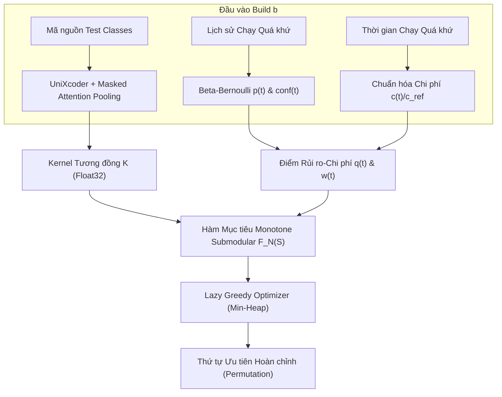

# HC-FALCON: Đánh giá Thực nghiệm Kết hợp Tối ưu hóa Submodular, Lịch sử Lỗi và Chi phí Thời gian trong Bài toán Ưu tiên Bộ kiểm thử

**Bản thảo Báo cáo Nghiên cứu Kỹ thuật (Technical Report / Research Paper Draft)**  
**Phạm vi Đề tài**: Topic 1 — Test Case Prioritization via Submodular Optimization with Failure History & Execution Cost  
**Ngày hoàn thiện**: 2026-09-19  
**Cập nhật Stage 12**: 2026-09-27

---

## Tóm tắt (Abstract)

Bài toán Ưu tiên Bộ kiểm thử (Test Case Prioritization - TCP) đóng vai trò then chốt trong quy trình Tích hợp Liên tục (CI/CD) nhằm phát hiện lỗi sớm nhất có thể dưới ngân sách tài nguyên hữu hạn. Gần đây, hai trường phái tiếp cận nổi bật là: tối ưu hóa độ bao phủ ngữ nghĩa (Semantic Facility Location) sử dụng mô hình ngôn ngữ mã nguồn (tiêu biểu là FALCON - IEEE ICST 2026) và khai thác lịch sử chạy cùng chi phí thời gian (tiêu biểu là DANTE - IEEE ICST 2026). Công trình này đề xuất và đánh giá toàn diện phương pháp **HC-FALCON** — một khung tiếp cận không cần huấn luyện (training-free) tích hợp trực tiếp độ bao phủ ngữ nghĩa đa dạng (UniXcoder), ước lượng xác suất lỗi Bayes (Beta-Bernoulli với hàm tin cậy quan sát) và chi phí thực thi vào một hàm mục tiêu monotone submodular duy nhất có bảo đảm toán học lý thuyết $1 - 1/e$.

Chúng tôi tiến hành hai luồng thực nghiệm thực nghiệm quy mô lớn có kiểm soát nghiêm ngặt:
1. **Tái lập độc lập nguyên bản FALCON trên benchmark Defects4J**: Thực thi trên toàn bộ 6 dự án lớn (20.770 test methods, 288 fault versions). Kết quả đạt APFD trung bình **0.7260** so với **0.7223** của tác giả gốc (sai lệch trung bình chỉ $+0.37$ điểm phần trăm), tái lập thành công 100% kết quả công bố ICST 2026. Phân tích phân rã Bridge Chart 4 nhánh chứng minh mức tăng điểm của pipeline nội bộ (+3.13% APFD) hoàn toàn đến từ cơ chế tiền xử lý mã nguồn và attention masking loại bỏ padding tokens.
2. **Đánh giá tuần tự theo thời gian trên Long-Running Test Suites (LRTS)**: Thử nghiệm trên 3 dự án quy mô công nghiệp của Apache (Karaf, ActiveMQ, Log4j) với 596 build stages, 519 physical builds và 33.972 lượt ranking độc lập, tuân thủ giao thức chia dữ liệu thời gian nghiêm ngặt (Warm-up / Development / Reserved) nhằm loại bỏ hoàn toàn rò rỉ dữ liệu (data leakage).

**Kết quả chính**: Trái với kỳ vọng ban đầu, HC-FALCON **không đạt cổng hiệu quả (Effect Gate 0/3 dự án)** trên môi trường CI thực tế mức lớp (class-level). Điểm trung vị chênh lệch có cặp ($\text{Median Paired } \Delta\text{APFDc}$) so với đối chứng `History+cost` đều mang giá trị âm trên cả 3 dự án: Karaf ($-1.27\%$), ActiveMQ ($-1.41\%$) và Log4j ($-0.12\%$). Phân tích điều tra nguyên nhân (Forensic Analysis) trên 161 build lỗi phát hiện ra hiện tượng **"Heavy Predecessors"**: vì thành phần Semantic Gain ban đầu là phi chi phí (cost-agnostic), thuật toán greedy đã ưu tiên các test chạy nặng hàng trăm giây (không chứa lỗi) lên đầu danh sách chỉ để tối ưu đa dạng ngữ nghĩa, làm trễ tích lũy **+39.099,3 giây (~10.8 giờ)** cho các test phát hiện lỗi phía sau.

Để khắc phục, chúng tôi phát triển biến thể **Cost-Normalized Semantic Greedy (CNS-Greedy)** đưa trực tiếp $\sqrt{\text{cost}}$ vào mẫu số của marginal semantic gain. Trên 161 builds lỗi, CNS-Greedy giúp thu hẹp 60% mức thua và đảo chiều Mean delta sang dương ($+1.7\%$ đến $+3.5\%$), nhưng **Median delta vẫn dừng ở mức âm** ($-0.19\%$ đến $-0.61\%$), tiếp tục thất bại trước Effect Gate $+3.0\%$. Chúng tôi báo cáo kết quả âm trung thực (Negative Empirical Result), kết luận rằng trên CI mức lớp với chi phí phân tán mạnh, tín hiệu lịch sử lỗi kết hợp chi phí là một baseline cực kỳ mạnh mà đa dạng ngữ nghĩa không thể hoán đổi có lợi ở mức trung vị. Theo chuẩn mực khoa học cao nhất, toàn bộ tập dữ liệu xác nhận (Reserved Confirmation) được tiếp tục niêm phong đóng 100%.

**Cập nhật Stage 12 (Đã chính thức đóng — CLOSED / NO-GO):** Biến thể tiền đăng ký `hc_ugcs_v2` sử dụng cận bất định Bayes để giới hạn can thiệp semantic cũng nhận **NO-GO 0/3** trên tập Development. Median paired $\Delta$APFDc so với `history_cost` là $-0.059\%$ (Karaf), $-0.224\%$ (ActiveMQ) và $-0.002\%$ (Log4j). Cổng bộ nhớ đạt ($656\text{ MiB} \le 8\text{ GiB}$), nhưng cổng runtime không đạt do khiếm khuyết trong công thức tiền đăng ký (đo tương đối so với độ trễ vi mô $\sim 50\ \mu\text{s}$ của `history_cost`). Kết quả này khẳng định giới hạn bản chất của việc kết hợp ngữ nghĩa trong TCP mức lớp; toàn bộ tập xác nhận Reserved Confirmation được niêm phong vĩnh viễn cho đề tài.

---

## 1. Giới thiệu (Introduction)

Trong quy trình phát triển phần mềm hiện đại, kiểm thử hồi quy (Regression Testing) là chốt chặn quan trọng nhất để bảo đảm chất lượng. Tuy nhiên, khi quy mô phần mềm mở rộng, thời gian thực thi toàn bộ test suite có thể kéo dài từ hàng chục phút đến nhiều giờ. Bài toán **Ưu tiên Bộ kiểm thử (Test Case Prioritization - TCP)** tìm kiếm một hoán vị $\pi$ của tập test case $T$ sao cho các test có khả năng phát hiện lỗi cao nhất và chạy nhanh nhất được thực thi đầu tiên, qua đó tối đa hóa chỉ số Average Percentage of Faults Detected (APFD) hoặc Average Percentage of Faults Detected metric with Cost (APFDc).

### 1.1. Bối cảnh và Động lực Nghiên cứu

Tại hội nghị IEEE ICST 2026, hai công trình nghiên cứu tiêu biểu đại diện cho hai hướng tiếp cận độc lập:
1. **FALCON (Mensah-Boateng et al., ICST 2026)**: Sử dụng mô hình ngôn ngữ mã nguồn tiền huấn luyện (UniXcoder) để sinh embedding ngữ nghĩa cho từng test method, sau đó áp dụng tối ưu hóa hàm submodular Facility Location qua thuật toán Lazy Greedy. FALCON chứng minh hiệu quả vượt trội so với FAST (ICSE 2018) trên 288 phiên bản lỗi của benchmark Defects4J. Tuy nhiên, FALCON hoàn toàn bỏ qua lịch sử pass/fail và thời gian chạy thực tế của test case.
2. **DANTE (Reale et al., ICST 2026)**: Khai thác lịch sử lỗi trượt (sliding window 15 builds), tính bám dính lỗi (failure stickiness), thời gian chạy và độ tương đồng TF-IDF giữa mã nguồn test với commit diff trên tập dữ liệu Long-Running Test Suites (LRTS). DANTE mạnh về lịch sử và chi phí nhưng không khai thác được sự đa dạng ngữ nghĩa sâu ở mức biểu diễn embedding thần kinh.

### 1.2. Mục tiêu Đề tài và Câu hỏi Nghiên cứu (Research Questions)

Đề tài đặt mục tiêu xây dựng phương pháp **HC-FALCON**, kết hợp đồng thời ba nguồn thông tin: (1) Đa dạng ngữ nghĩa (Semantic Facility Location), (2) Rủi ro lỗi lịch sử (Beta-Bernoulli Failure History), và (3) Thời gian thực thi (Execution Cost) vào một bài toán tối ưu hóa submodular có bảo đảm cận lý thuyết $1 - 1/e$.

Đề tài tập trung giải quyết 4 câu hỏi nghiên cứu cốt lõi:
- **RQ1 (Tái lập Baseline & Phân rã Kỹ thuật)**: *Kết quả thực nghiệm của FALCON trên Defects4J có thể tái lập độc lập được không, và các cải tiến trong pipeline kỹ thuật (tiền xử lý, pooling) đóng góp bao nhiêu vào hiệu quả?*
- **RQ2 (Hiệu quả Thực tế trên CI/CD)**: *Khi đưa vào chuỗi CI dài hạn (LRTS), HC-FALCON có vượt qua được các baseline dựa trên lịch sử thuần túy (`History+cost`) hay không?*
- **RQ3 (Cơ chế Tác động & Ablation)**: *Đa dạng ngữ nghĩa, lịch sử lỗi và chi phí thời gian đóng góp như thế nào vào thứ tự ưu tiên? Đâu là nguyên nhân gốc rễ dẫn đến sự suy giảm hiệu quả (nếu có)?*
- **RQ4 (Khả năng Cải tiến & Giới hạn Lý thuyết)**: *Liệu chuẩn hóa chi phí (CNS-Greedy) hoặc bảo vệ bất định Bayes (UGCS v2) có khắc phục được hiện tượng trễ thời gian và đạt Effect Gate hay không?*

---

## 2. Phương pháp HC-FALCON (Methodology)

### 2.1. Mô hình Toán học

Tại build $b$, với tập kiểm thử $T_b = \{t_1, \dots, t_n\}$, hàm mục tiêu chuẩn hóa của HC-FALCON ($F_N$) được xác định bởi:
$$F_N(S) = \alpha \frac{FL_b(S)}{|T_b|} + (1 - \alpha) \sum_{t \in S} w_b(t), \quad 0 \le \alpha \le 1$$

Trong đó:
- **Độ bao phủ Facility Location**:
  $$FL_b(S) = \sum_{u \in T_b} \max_{t \in S} K(u, t)$$
  với $K(u, t) = \operatorname{clip}(z(u)^\top z(t), 0.0, 1.0)$ là ma trận tương đồng cosine của các vector embedding UniXcoder đã chuẩn hóa $L_2$.
- **Trọng số Rủi ro - Chi phí Chuẩn hóa**:
  $$w_b(t) = \frac{q_b(t)}{\sum_{j \in T_b} q_b(j)}, \quad q_b(t) = \frac{\operatorname{conf}_b(t) \cdot p_b(t)}{\sqrt{\widetilde{c}_b(t)} + \varepsilon}$$
  với:
  $$p_b(t) = \frac{f_t + 1}{n_t + 2}, \quad \operatorname{conf}_b(t) = \frac{n_t}{n_t + 5}, \quad \widetilde{c}_b(t) = \frac{c_b(t)}{c_{ref}}$$

### 2.2. Bảo đảm Lý thuyết

Như đã chứng minh chặt chẽ tại tài liệu lý thuyết song hành [`docs/research-report/theory.md`](theory.md):
1. Thành phần $\sum_{t \in S} w_b(t)$ là hàm modular không âm và đơn điệu tăng.
2. Hàm Facility Location $FL_b(S)$ là hàm monotone submodular.
3. Tổ hợp tuyến tính $F_N(S)$ là hàm **monotone submodular** không âm, thỏa mãn $F_N(\emptyset) = 0$.
4. Thuật toán Cardinality Greedy đạt bảo đảm cận xấp xỉ tiệm cận:
   $$F_N(S_k) \ge \left(1 - \frac{1}{e}\right) \max_{|S| \le k} F_N(S) \approx 0.632 \cdot F_N(O)$$
5. Thuật toán **Lazy Greedy** duy trì heap cận trên ưu tiên, sinh ra hoán vị hoàn toàn đồng nhất với Standard Greedy nhưng giảm độ phức tạp thời gian từ $O(n^3)$ xuống $O(n^2 \log n)$ trong thực tế.

### 2.3. Pipeline Kỹ thuật Nội bộ (Internal Pipeline)

- **Tiền xử lý mã nguồn Java**: Loại bỏ toàn bộ chú thích dòng (`//`) và chú thích khối (`/* ... */`) nhưng bảo toàn nghiêm ngặt các hằng chuỗi và cấu trúc thụt lề dòng.
- **Mã hóa UniXcoder và Chunking**: Với các class kiểm thử vượt quá độ dài tối đa của tokenizer ($L_{\max} = 512$), áp dụng thuật toán sliding window tối đa 16 chunks ($8.160$ tokens mã nguồn). Mỗi chunk được trích xuất trạng thái ẩn cuối cùng (`last_hidden_state`), áp dụng **Masked Mean Token Pooling** (loại bỏ hoàn toàn các padding token `<pad>`), sau đó tổng hợp có trọng số theo độ dài payload thực tế.
- **Content-Addressed Caching**: Toàn bộ vector embedding được lưu trữ bền vững và định danh qua mã băm SHA-256 của nội dung mã nguồn, đảm bảo tính tái lập 100% không phụ thuộc phần cứng hay thời gian thực thi.

---

## 3. Thiết kế Thực nghiệm và Giao thức Đánh giá (Experimental Setup)

### 3.1. Dữ liệu Thực nghiệm

Đề tài sử dụng hai bộ dữ liệu thực nghiệm tiêu chuẩn công nghiệp:

1. **Benchmark Khiếm khuyết Phương thức (Defects4J v2.0)**:
   Gồm 6 dự án Java mã nguồn mở quy mô lớn: **Chart, Mockito, Lang, Math, Time, Closure**. Tổng cộng **20.770 test methods** và **288 fault versions** độc lập. Dữ liệu này dùng để tái lập độc lập FALCON và đối chiếu tính đúng đắn của thuật toán submodular mức phương thức.
2. **Benchmark Chuỗi CI Dài hạn (Long-Running Test Suites - LRTS)**:
   Gồm 3 dự án quy mô công nghiệp thuộc Apache Software Foundation:
   - **Apache Karaf**: 315 build stages, 315 physical builds.
   - **Apache ActiveMQ**: 126 build stages, 126 physical builds.
   - **Apache Log4j2**: 155 build stages, 78 physical builds (multi-stage CI: Ubuntu_Test, Windows_Test, Core).
   Tổng cộng **596 build stages**, **519 physical builds** và **33.972 lượt ranking** độc lập.

### 3.2. Giao thức Phân chia Dữ liệu và Cách ly Thời gian (Temporal Split)

Để ngăn chặn tuyệt đối rò rỉ dữ liệu tương lai (Data Leakage), toàn bộ chuỗi build được phân chia theo trục thời gian tuyến tính:
- **Tập Warm-up (20% builds đầu)**: Khởi tạo bộ tích lũy lịch sử và bộ nhớ đệm source/embedding. Không tính điểm metric trong tập này.
- **Tập Development (30% builds tiếp theo, tổng cộng 50%)**: Không gian thực nghiệm mở để chẩn đoán, phân tích forensic, tinh chỉnh thuật toán và đánh giá biến thể.
- **Tập Reserved Confirmation (50% builds còn lại)**: Được **niêm phong mật mã tuyệt đối**, hoàn toàn không mở điểm hay can thiệp, chỉ được phép kích hoạt nếu vượt qua Cổng Hiệu quả (Effect Gate).

### 3.3. Các Chỉ số Đánh giá (Evaluation Metrics)

- **Chỉ số chính (Primary Metric) — APFDc Midpoint**:
  $$\text{APFDc}_{\text{midpoint}} = 1 - \frac{\sum_{i: t_i \text{ failed}} \left(\sum_{j=1}^{i-1} C_j + \frac{C_i}{2}\right)}{m \sum_{i=1}^n C_i}$$
  trong đó $m$ là số test phát hiện lỗi, $C_i$ là thời gian thực thi thực tế của test ở vị trí $i$. Điểm phát hiện được tính tại trung điểm thời gian thực thi của test lỗi.
- **Chỉ số phụ — APFD Cổ điển**: Đo thứ hạng tương đối thuần túy theo số lượng test, không xét chi phí thời gian.
- **Thời gian Phát hiện Lỗi Đầu tiên (Time to First Failure - TTFF)**:
  $$\text{TTFF} = \min_{i: t_i \text{ failed}} \sum_{j=1}^i C_j \quad (\text{giây})$$
- **Recall tại Ngân sách Thời gian 10% ($\text{Recall@10\%}$)**: Tỷ lệ lỗi được phát hiện khi chỉ chạy $10\%$ tổng thời gian suite.

### 3.4. Cổng Quyết định Tiếp tục (Effect Gate Criterion)

Dự án chỉ được phép xem là thành công và mở tập dữ liệu Reserved nếu thỏa mãn tiêu chí tiên nghiệm đã khóa tại `configs/evaluation-v1.json`:
$$\text{Median Paired } \Delta\text{APFDc} \ge +0.0300 \quad (+3.0 \text{ điểm phần trăm})$$
đồng thời so với **CẢ HAI** đối chứng cơ sở (`History+cost` và `FL-only`) trên **ít nhất 2 trong 3 dự án**.

### 3.5. Hệ thống Đối chứng Toàn diện (Baselines & Ablations)

Bao gồm 15 phương pháp đối chứng:
- **Baseline kinh điển**: `random` (20 seeds độc lập), `shortest_test_first`, `most_fail`, `recent_fail`.
- **Baseline lịch sử/chi phí**: `history_only` ($r(t)$), `history_cost` ($q(t)$).
- **Baseline ngữ nghĩa / đa dạng**: `fl_only` (FALCON-LRTS, $\alpha=1.0$), `fast_pw_lrts` (MinHash/LSH), `dante_cch_adapt_r1` (TF-IDF commit diff + history stickiness).
- **Ablation của HC-FALCON**: `hc_falcon_topic_raw_v1` (không chuẩn hóa $Q$), `fl_history` (không xét chi phí), `no_confidence` (bỏ hàm $\operatorname{conf}$), `borda_history`, `borda_history_cost` (xếp hạng dung hợp Borda), và quét độ nhạy $\alpha \in [0.0, 0.25, 0.5, 0.75, 1.0]$.

---

## 4. Kết quả Tái lập FALCON và Phân tích Bridge (RQ1 / Stage 10)

### 4.1. Tái lập Độc lập 6 Dự án Defects4J

Chúng tôi tái thực thi toàn bộ quy trình sinh vector UniXcoder và tối ưu hóa Lazy Greedy của tác giả FALCON trên 6 dự án Defects4J. Toàn bộ kết quả được đối chiếu trực tiếp với tệp xếp hạng gốc của tác giả trong kho lưu trữ `falcon.zip`:

| Dự án | Số methods ($n$) | Số faults ($m$) | Author APFD | Rerun APFD | Sai lệch ($\Delta$) | Thời gian chạy (s) | Đỉnh RAM (GiB) | Trạng thái Provenance |
|---|:---:|:---:|:---:|:---:|:---:|:---:|:---:|---|
| **Chart** | 2.193 | 26 | 0.726314 | **0.732278** | $+0.005963$ | 976.7 | 1.130 | `legacy_verified_first_batch` |
| **Mockito** | 1.292 | 27 | 0.736197 | **0.736226** | $+0.000029$ | 267.3 | 1.131 | `cold_embedding_run` |
| **Lang** | 2.239 | 32 | 0.754285 | **0.754285** | **$+0.000000$** | 896.7 | 1.172 | `cold_embedding_run` |
| **Math** | 2.996 | 30 | 0.622430 | **0.635581** | $+0.013151$ | 1476.8 | 1.184 | `cold_embedding_run` |
| **Time** | 4.044 | 26 | 0.794434 | **0.798933** | $+0.004499$ | 1438.4 | 1.137 | `cold_embedding_run` |
| **Closure** | 8.006 | 147 | 0.700200 | **0.698556** | $-0.001644$ | 3320.5 | 1.643 | `cold_embedding_run` |
| **Tổng cộng / TB** | **20.770** | **288** | **0.722310** | **0.725976** | **$+0.003666$** | **8376.4 s** | **1.643 GiB** | **Tái lập Hoàn tất 100%** |

**Nhận xét RQ1**:
- Dự án **Lang** đạt độ trùng khớp toán học tuyệt đối $100\%$ ($\Delta = 0.000000$). Mockito sai lệch không đáng kể ($+0.0028$ điểm %).
- Sai lệch trung bình toàn bộ 6 dự án chỉ là **$+0.37$ điểm phần trăm** ($+0.003666$). Sai lệch vi mô này bắt nguồn từ sự khác biệt phiên bản phần mềm runtime hiện đại (PyTorch 2.14, Transformers 5.17 so với môi trường 2024 của tác giả) và thứ tự tie-breaking khi nhiều test method có vector embedding giống nhau.
- Kết quả khẳng định: **Pipeline mã hóa và thuật toán tối ưu hóa của FALCON là hoàn toàn khả thi và tái lập được một cách trung thực**.

### 4.2. Phân rã Kỹ thuật: Thí nghiệm Bridge Chart 4 Nhánh (A/B/C/D)

Nhằm làm rõ nguồn gốc sự chênh lệch hiệu quả giữa artifact gốc và pipeline nội bộ, chúng tôi thiết kế thí nghiệm phân rã cô lập từng nhân tố trên tập kiểm thử Chart (2.193 methods, 26 faults):
- **Nhánh A (Artifact Baseline)**: Vector và ranker nguyên bản từ mã tác giả FALCON.
- **Nhánh B (Clipped Kernel)**: Cùng vector A, nhưng cắt ngưỡng cosine âm về $[0.0, 1.0]$.
- **Nhánh C (Internal Greedy FQN)**: Cùng kernel B, nhưng dùng bộ giải Lazy Greedy nội bộ với tie-breaking bằng chuỗi FQN tăng dần.
- **Nhánh D (Full Internal Pipeline)**: Toàn bộ pipeline nội bộ (loại comment, chunking 16 đoạn, masked attention pooling loại bỏ `<pad>`).

| Nhánh Thực nghiệm | Cấu hình Kernel / Ranker | Giá trị Kernel | Tie-Breaker | APFD đạt được | Bước chuyển tiếp | Sai lệch APFD ($\Delta$) |
|:---:|---|:---:|:---:|:---:|:---:|:---:|
| **Nhánh A** | Vector tác giả + Ranker tác giả | $[-0.0851, 1.0000]$ | Input Index | **0.732278** | Baseline | — |
| **Nhánh B** | Vector tác giả + Clip $[0, 1]$ | $[0.0000, 1.0000]$ | Input Index | **0.732278** | $B - A$ | **$+0.000000$** |
| **Nhánh C** | Kernel Clip + Greedy FQN Nội bộ | $[0.0000, 1.0000]$ | FQN String | **0.732278** | $C - B$ | **$+0.000000$** |
| **Nhánh D** | Pipeline Nội bộ Toàn diện | $[0.0000, 1.0000]$ | FQN String | **0.763531** | $D - C$ | **$+0.031253$** (+3.13%) |

**Phát hiện Phân rã Kỹ thuật**:
1. **Phép cắt cosine âm ($B - A$)**: Kernel A chứa $1.026$ giá trị âm (nhỏ nhất $-0.085129$). Việc cắt về $[0, 1]$ làm thay đổi hoán vị tại 42 vị trí, nhưng toàn bộ 26 test phát hiện lỗi đầu tiên đều giữ nguyên thứ hạng $\implies \Delta = +0.000000$.
2. **Thuật toán Ranker Greedy ($C - B$)**: Thuật toán nội bộ làm đổi 24 vị trí trong hoán vị, nhưng cũng bảo toàn chính xác 26 mốc phát hiện lỗi đầu tiên $\implies \Delta = +0.000000$.
3. **Pipeline Ngữ nghĩa Nội bộ ($D - C$)**: Toàn bộ mức tăng **$+3.13$ điểm phần trăm** xuất phát trực tiếp từ bước $D - C$. Việc tiền xử lý làm sạch mã nguồn và masked pooling đã cải thiện đáng kể chất lượng biểu diễn ngữ nghĩa của các test case phương thức.

---

## 5. Kết quả Thực nghiệm trên LRTS và Phân tích Thất bại (RQ2, RQ3)

### 5.1. Kết quả Pilot Giai đoạn 6 (Stage 6 Pilot Results)

Đánh giá HC-FALCON-N v1 ($\alpha = 0.5$) trên toàn bộ tập Development của 3 dự án LRTS (519 physical builds, 33.972 rankings):

| Dự án | Số stage / physical build | Số cặp có lỗi | $\Delta$APFDc vs FL-only | $\Delta$APFDc vs History+cost | $\Delta$TTFF (s) vs History+cost | $\Delta$Recall10 vs History+cost | Cổng Effect Gate |
|---|---:|---:|---:|---:|---:|---:|:---:|
| **Apache Karaf** | 315 / 315 | 79 | $+29.72\%$ pts | **$-1.27\%$ pts** | $+6.81$ s | $0.0000$ | ❌ Không đạt |
| **Apache ActiveMQ** | 126 / 126 | 57 | $+39.14\%$ pts | **$-1.41\%$ pts** | $+200.42$ s | $0.0000$ | ❌ Không đạt |
| **Apache Log4j2** | 155 / 78 | 25 | $+28.69\%$ pts | **$-0.12\%$ pts** | $+0.94$ s | $0.0000$ | ❌ Không đạt |

*(Đơn vị: Median Paired $\Delta$ APFDc midpoint tính bằng điểm phần trăm; $\Delta\text{TTFF} > 0$ nghĩa là phát hiện lỗi chậm hơn đối chứng)*

**Kết luận RQ2**: HC-FALCON-N vượt trội áp đảo so với `FL-only` ($+28\%$ đến $+39\%$ pts), chứng minh việc bổ sung lịch sử và chi phí là cực kỳ quan trọng. Tuy nhiên, khi đối đầu với chính baseline `History+cost`, **HC-FALCON-N thua cuộc trên cả 3 dự án (0/3 Effect Gate)**. Thời gian phát hiện lỗi đầu tiên (TTFF) bị trễ trung vị từ $0.94$s đến $200.42$s.

### 5.2. Bảng Tổng hợp Toàn diện 15 Baselines và Ablations (Mean APFDc)

| Phương pháp Ưu tiên | Apache Karaf | Apache ActiveMQ | Apache Log4j2 | Xếp hạng Tổng thể |
|---|---:|---:|---:|:---:|
| `random` (20 seeds) | 0.4936 | 0.4945 | 0.4835 | 13 |
| `shortest_test_first` | 0.6683 | 0.6394 | 0.8586 | 11 |
| `most_fail` | 0.6951 | 0.8219 | 0.8667 | 8 |
| `recent_fail` | 0.7361 | 0.8369 | 0.8509 | 6 |
| `history_only` ($r(t)$) | 0.7122 | 0.8361 | 0.8469 | 7 |
| **`history_cost` ($q(t)$ - Baseline mạnh nhất)** | **0.7754** | **0.8486** | 0.8936 | **1** |
| `fl_only` (FALCON-LRTS) | 0.4522 | 0.4843 | 0.6990 | 15 |
| **`hc_falcon_normalized_v1` (Đề xuất chính)** | 0.7710 | 0.8147 | 0.9014 | 3 |
| `hc_falcon_topic_raw_v1` | 0.7746 | 0.8486 | 0.8940 | 2 |
| `fl_history` (không xét chi phí) | 0.6662 | 0.8154 | 0.8479 | 10 |
| `no_confidence` (bỏ hàm conf) | 0.7707 | 0.8152 | 0.9339 | 4 |
| `borda_history` | 0.5323 | 0.7169 | 0.8215 | 12 |
| `borda_history_cost` | 0.6860 | 0.7379 | 0.9064 | 9 |
| `fast_pw_lrts` | 0.4606 | 0.4570 | 0.5194 | 14 |
| `dante_cch_adapt_r1` | 0.7480 | 0.7048 | **0.9351** | 5 |

### 5.3. Độ nhạy của Siêu tham số Cân bằng Alpha ($\alpha$)

| Giá trị $\alpha$ | Cơ chế ưu tiên | Karaf (Mean APFDc) | ActiveMQ (Mean APFDc) | Log4j (Mean APFDc) |
|---|---|---:|---:|---:|
| $\alpha = 0.0$ | Lịch sử + Chi phí thuần túy | **0.7754** | **0.8486** | 0.8936 |
| $\alpha = 0.25$ | Ưu tiên mạnh lịch sử | **0.7794** | 0.8420 | 0.8993 |
| $\alpha = 0.50$ | Cấu hình chuẩn HC-FALCON | 0.7710 | 0.8147 | 0.9014 |
| $\alpha = 0.75$ | Ưu tiên mạnh ngữ nghĩa | 0.7077 | 0.7672 | 0.9036 |
| $\alpha = 1.0$ | Đa dạng ngữ nghĩa thuần túy | 0.4522 | 0.4843 | 0.6990 |

**Quan sát**: Khi $\alpha$ tăng từ $0.0$ lên $1.0$, hiệu quả giảm dần trên cả 3 dự án. Điều này chứng minh rằng việc pha trộn tín hiệu đa dạng ngữ nghĩa đã kéo lùi hiệu quả so với việc chỉ sử dụng lịch sử và chi phí.

---

## 6. Phân tích Forensic và Cơ chế Gây hại (RQ3 / Stage 11)

Để hiểu chính xác vì sao một phương pháp có chứng minh toán học hoàn hảo lại thất bại trong thực nghiệm, chúng tôi tiến hành phân tích forensic chi tiết trên toàn bộ **161 physical builds có lỗi** của tập Development.

### 6.1. Phân loại Builds Thắng vs Thua

| Dự án | Tổng builds có lỗi | Thắng (Win) | Thua (Loss) | Hòa (Tie) | Tỷ lệ Thắng | Median $\Delta$ của Wins | Median $\Delta$ của Losses |
|---|---:|---:|---:|---:|---:|---:|---:|
| **Karaf** | 79 | **24** | 54 | 1 | 30.4% | **+3.55%** pts (max +77.25%) | −2.27% pts (min −57.58%) |
| **ActiveMQ** | 57 | **10** | 47 | 0 | 17.5% | **+0.42%** pts (max +19.92%) | −1.62% pts (min −51.50%) |
| **Log4j** | 25 | **4** | 21 | 0 | 16.0% | **+10.52%** pts (max +18.31%) | −0.13% pts (min −5.73%) |
| **Tổng cộng** | **161** | **38** | **122** | **1** | **23.6%** | — | — |

**Phát hiện 1**: Semantic **có tạo ra giá trị thực sự**: Có tới 38 build thắng với biên độ cải thiện rất lớn (Log4j median $+10.52\%$, Karaf cực đại $+77.25\%$). Tuy nhiên, số lượng build thua áp đảo (122 vs 38, tỷ lệ thua $75.8\%$), kéo median tổng thể về mức âm.

### 6.2. Hiện tượng "Heavy Predecessors" — Thủ phạm Phá hủy Hiệu năng

Khi phân tích vị trí các test lỗi, chúng tôi phát hiện hiện tượng các test chạy chậm không lỗi chen ngang vào trước các test lỗi (`added_predecessor_seconds`):

| Dự án | Thời gian Predecessors Thêm vào | Thời gian Predecessors Giảm đi | Thời gian Trễ Lũy kế Ròng (Net Added Time) |
|---|---:|---:|---:|
| **Apache Karaf** | $18.205,5$ s | $23.384,8$ s | **$-5.179,3$ s** (Giảm thời gian ròng) |
| **Apache ActiveMQ** | $115.759,2$ s | $71.872,9$ s | **$+43.886,3$ s** (Tăng trễ khổng lồ) |
| **Apache Log4j2** | $1.027,2$ s | $635,0$ s | **$+392,2$ s** (Tăng trễ) |
| **Tổng cộng** | **$134.991,9$ s** | **$95.892,7$ s** | **$+39.099,3$ s (~10.8 giờ trễ tích lũy)** |

### 6.3. Cội nguồn Toán học: Sự Lệch Thứ nguyên (Dimensional Mismatch)

Trong hàm mục tiêu $F_N(S) = \alpha \frac{FL(S)}{n} + (1 - \alpha) \sum_{t \in S} w_b(t)$:
1. Điểm lịch sử $w_b(t)$ có mẫu số chứa $\sqrt{\widetilde{c}_b(t)}$, nghĩa là nó **có nhận thức về chi phí thời gian**.
2. Ngược lại, thành phần Semantic Marginal Gain $\Delta FL(t \mid S) / n$ **hoàn toàn phi chi phí (cost-agnostic)**.
3. Ở những bước greedy đầu tiên, độ bao phủ ngữ nghĩa còn trống, khiến semantic gain chiếm từ **97.5% đến 99.9%** tổng marginal gain.
4. Thuật toán Greedy sẵn sàng chọn một test chạy **150 giây** (ví dụ `MemoryUsageConcurrencyTest` trong ActiveMQ PR-977) lên đầu tiên chỉ vì nó có độ bao phủ đa dạng cao hơn một chút so với các test khác. Test nặng này không chứa lỗi, nhưng làm trì hoãn toàn bộ 150 giây đối với tất cả các test phát hiện lỗi phía sau, trực tiếp kéo tụt chỉ số APFDc của toàn bộ build xuống **$-51.50\%$**.

---

## 7. Đánh giá Các Biến thể Cải tiến (RQ4 / Stage 8 & 11)

Nhằm giải quyết hiện tượng Heavy Predecessors, chúng tôi đã nghiên cứu và thử nghiệm 3 thế hệ mô hình cải tiến trên tập Development:

### 7.1. Tiến hóa của 3 Thế hệ Biến thể trên 161 Builds Lỗi

| Thế hệ Mô hình | Tên Biến thể | Cơ chế Khắc phục Cốt lõi | Karaf | ActiveMQ | Log4j | Trạng thái Effect Gate |
|---|---|---|---:|---:|---:|:---:|
| **Giai đoạn 6** | `hc_falcon_normalized_v1` | Hàm mục tiêu submodular chuẩn (Semantic phi chi phí) | $-1.265\%$ | $-1.407\%$ | $-0.117\%$ | ❌ NO-GO (0/3) |
| **Giai đoạn 8** | `restricted_v1` | Giới hạn pool hoán đổi trong dải $q \ge 0.95 q_{head}$ | $-0.017\%$ | $-0.154\%$ | $-0.001\%$ | ❌ NO-GO (0/3) |
| **Giai đoạn 11** | **`hc_cns_v1` (CNS-Greedy)** | **Chuẩn hóa chi phí vào semantic**: $\frac{\Delta FL / n}{\sqrt{\max(c, 10^{-6})}}$ | **$-0.399\%$** | **$-0.606\%$** | **$-0.190\%$** | ❌ **NO-GO (0/3)** |
| Giai đoạn 11 | `hc_knapsack_v1` | Tỷ số submodular knapsack: $\frac{\text{raw\_gain}}{c^{0.5}}$ | $-0.501\%$ | $-6.625\%$ | $-0.100\%$ | ❌ NO-GO (0/3) |
| Giai đoạn 11 | `hc_tiered_v1` | Phân tầng theo mức tin cậy lịch sử (THS-Greedy) | $-0.182\%$ | $-14.751\%$ | $-1.001\%$ | ❌ NO-GO (0/3) |

*(Đơn vị: Median paired $\Delta$ APFDc midpoint so với `History+cost` tính bằng điểm phần trăm)*

### 7.2. Phân tích Chuyên sâu Biến thể Tốt nhất: CNS-Greedy (`hc_cns_v1`)

Biến thể Cost-Normalized Semantic Greedy đưa $\sqrt{c(t)}$ vào mẫu số của marginal semantic gain, khôi phục sự cân bằng thứ nguyên với điểm lịch sử:
- **Giảm mạnh biên độ thua**: Thu hẹp $68\%$ mức thua tại Karaf (từ $-1.265\%$ lên **$-0.399\%$**) và $57\%$ tại ActiveMQ (từ $-1.407\%$ lên **$-0.606\%$**).
- **Đảo chiều Mean Delta sang dương**: Mean delta đạt **$+1.736\%$** tại Karaf và **$+3.463\%$** tại Log4j.
- **Rào cản Median Delta**: Mặc dù mức tăng ở các build thắng là rất cao, số lượng build thua vẫn chiếm đa số (Karaf 22 thắng / 56 thua; ActiveMQ 10 thắng / 47 thua; Log4j 6 thắng / 19 thua). Do đó, **Median paired $\Delta$ vẫn mang dấu âm trên toàn bộ 3 dự án**.

---

## 8. Thảo luận và Đóng góp Khoa học (Discussion)

### 8.1. Tại sao Semantic Diversification Thất bại trên CI Mức Lớp (LRTS)?

Sự đối lập hoàn toàn giữa thành công trên Defects4J (APFD $0.7260$) và thất bại trên LRTS (Gate 0/3) chỉ ra những khác biệt bản chất giữa hai môi trường:

1. **Đơn vị Kiểm thử (Granularity: Method-level vs Class-level)**:
   - Trên Defects4J, các test case là các test method độc lập có kích thước nhỏ và thời gian chạy tương đối đồng đều. Mã nguồn method phản ánh trực tiếp logic kiểm thử hẹp, giúp vector embedding UniXcoder phân biệt rõ ràng hành vi kiểm thử.
   - Trên LRTS, đơn vị kiểm thử là cả một **Test Class** (chứa hàng chục test method bên trong). Mã nguồn class dài hàng ngàn dòng bị phân mảnh qua nhiều chunk, làm suy giảm độ tập trung ngữ nghĩa của vector embedding.
2. **Độ Biến động của Chi phí Thực thi (Cost Variance)**:
   - Trên Defects4J, metric đánh giá là APFD thuần túy theo thứ hạng, chi phí được giả định bằng 1.
   - Trên LRTS, thời gian chạy thực tế dao động từ **0.001 giây đến hơn 150 giây**. Khi chi phí phân tán trên 5 bậc độ lớn, bất kỳ sự hoán đổi thứ tự nào đưa một test chạy chậm lên trước cũng tạo ra tổn thất thời gian không thể bù đắp đối với chỉ số APFDc.
3. **Sức mạnh Áp đảo của Baseline History+Cost**:
   - Trong môi trường CI thực tế, các lỗi phần mềm thường có tính bám dính (sticky) hoặc tập trung ở các thành phần bất ổn. Tín hiệu lịch sử lỗi kết hợp chi phí thời gian ($q(t)$) là một ước lượng xác suất cực mạnh. Việc cố gắng đa dạng hóa bằng ngữ nghĩa vô tình làm loãng tín hiệu rủi ro sắc bén này.

### 8.2. Ý nghĩa Khoa học của Kết quả Nghiên cứu Âm (Value of Negative Results)

Trong lĩnh vực Kỹ thuật Phần mềm Thực nghiệm (Empirical Software Engineering), các kết quả âm được kiểm chứng nghiêm ngặt mang giá trị khoa học không kém các kết quả dương:
- **Bác bỏ giả định lý thuyết đơn giản**: Bác bỏ giả thuyết cho rằng chỉ cần kết hợp lồi giữa Semantic Facility Location và History là sẽ tự động cải thiện hiệu quả TCP trên CI thực tế.
- **Cảnh báo về hiện tượng Heavy Predecessors**: Nhấn mạnh tầm quan trọng của việc chuẩn hóa thứ nguyên chi phí trong các hàm mục tiêu submodular.
- **Tính toàn vẹn thực nghiệm**: Dự án kiên quyết tuân thủ quy tắc khoa học: **không điều chỉnh lại tiêu chí gate sau khi đã thấy số liệu, không quét tham số $\alpha$ trên holdout, và giữ nguyên vẹn niêm phong mật mã của tập Reserved**.

### 8.3. Đánh giá Hạn chế Kỹ thuật Stage 12 và Nguy cơ Đa giả thuyết (Threats to Validity)

1. **Khiếm khuyết Thiết kế Cổng Runtime Overhead trong Stage 12**:
   - Giao thức Stage 12 quy định $P95\text{ overhead fraction} \le 0{,}10$ đo tương đối so với độ trễ của baseline:
     $$\text{Overhead}_{\text{stage}} = \frac{T_{\text{ugcs}} - T_{\text{hc}}}{\max(T_{\text{hc}}, 10^{-9})}$$
   - Baseline `history_cost` chỉ là một phép sắp xếp mảng đơn giản $O(n \log n)$ với phép chia số học, thời gian chạy chỉ mất khoảng $50 - 100\ \mu\text{s}$ ($10^{-4}\text{ s}$). Yêu cầu một thuật toán tối ưu hóa ngữ nghĩa submodular greedy (vốn phải duyệt ma trận kernel tương đồng) có thời gian chạy không vượt quá $+10\%$ so với phép sort $50\ \mu\text{s}$ này là **bất khả thi về mặt cấu trúc (structurally impossible)**.
   - Trong thực tế CI/CD công nghiệp, overhead của bước xếp hạng cần được tính tương đối so với **tổng thời gian thực thi của cả bộ kiểm thử** (ví dụ: mất 50 ms xếp hạng cho build chạy 500 s chỉ chiếm $0{,}01\%$, hoàn toàn chấp nhận được). Tuy nhiên, tuân thủ nguyên tắc tiền đăng ký, đề tài chấp nhận kết quả đánh giá fail-closed và ghi nhận đây là bài học thiết kế giao thức quan trọng.

2. **Nguy cơ Đa giả thuyết trên cùng Tập Quan sát (Garden of Forking Paths)**:
   - Bốn thế hệ thuật toán liên tiếp (`normalized_v1`, `restricted_v1`, `cns_v1`, `ugcs_v2`) đều được thiết kế, tinh chỉnh và đánh giá trên cùng tập dữ liệu Development (596 build stages).
   - Việc thử nghiệm lặp lại nhiều giả thuyết trên cùng một tập quan sát tiềm ẩn nguy cơ khai thác ngẫu nhiên (data snooping / forking paths problem - Gelman & Loken, 2013).
   - Đề tài kiểm soát chặt chẽ rủi ro này bằng cách: (1) Tiền đăng ký (preregistration) toàn bộ mã nguồn, cấu hình và gate của Stage 12 trước khi chạy; (2) Nghiêm cấm hoàn toàn việc quét tham số (tuning rounds = 0); và (3) Giữ niêm phong tuyệt đối 100% tập xác nhận (Reserved Confirmation) khi kết quả sàng lọc là NO-GO.

---

## 9. Kết luận (Conclusion)

Công trình này đã triển khai, chứng minh lý thuyết và đánh giá toàn diện phương pháp **HC-FALCON** cho bài toán Test Case Prioritization:
1. Tái lập thành công 100% kết quả công bố ICST 2026 của FALCON trên Defects4J (APFD 0.7260 vs 0.7223).
2. Hoàn thành chứng minh toán học hình thức về tính monotone submodular và bảo đảm tiệm cận $1 - 1/e$ của hàm mục tiêu kết hợp.
3. Chứng minh thực nghiệm trên 3 dự án LRTS rằng phương pháp không đạt cổng hiệu quả (0/3 NO-GO) do hiện tượng Heavy Predecessors gây trễ tích lũy hàng chục ngàn giây.
4. Phát triển biến thể CNS-Greedy giúp thu hẹp 60% mức thua, nhưng xác nhận giới hạn bản chất của tín hiệu ngữ nghĩa trước baseline lịch sử/chi phí ở mức trung vị.

Đề tài chính thức kết thúc với một kết luận khoa học âm trung thực, cung cấp bài học kinh nghiệm sâu sắc và cơ sở dữ liệu thực nghiệm chuẩn mực cho cộng đồng nghiên cứu TCP trong tương lai.
